<a id="top"></a>

<p align="center">
  
</p>

<h1 align="center">Edward P. Smith, PhD (c), M.S.A., M.S.U.S.</h1>

<p align="center"><strong>Technical &amp; Service e-Portfolio</strong><br>
Business Intelligence · Microsoft Power Platform · Knowledge Management · Microsoft 365 Solutions</p>

<p align="center">
  <a href="https://www.linkedin.com/in/edward-smith-9820a168">LinkedIn</a> ·
  <a href="https://learn.microsoft.com/en-us/users/smithe46/">Microsoft Learn Profile</a> ·
  <a href="https://learn.microsoft.com/en-us/users/smithe46/transcript/d9rkwsl684pqpqz">Microsoft Learn Transcript</a> ·
  <a href="https://sites.google.com/view/edwardstechportfolio/home">Original Google Sites Portfolio</a> ·
  <a href="https://sites.google.com/view/space-studies-and-research-aca/home">Space Studies &amp; Research</a>
</p>

<p align="center">
  
  
  
  
  
  
</p>

---

## Background

With a decade of experience driving data-informed decision-making in the U.S. Navy, I've leveraged the Microsoft Power Platform to turn complex operational data into actionable intelligence. As a Knowledge Manager and business intelligence analyst, I've built and maintained dozens of SharePoint- and Power Apps-based solutions, implemented 17+ automated workflows in Power Automate, and developed numerous Power BI dashboards that enhance mission readiness, training effectiveness, and governance transparency.

Proficient in DAX, database administration, and statistical tools such as G\*Power, I combine rigorous analytics with practical process automation to deliver secure, user-centered BI products that improve collaboration, increase productivity, and elevate organizational performance.

## Portfolio at a Glance

| Area | Solutions | Highlights |
|---|---:|---|
| [Power Platform Works](power-platform/README.md) | 17 | Power BI dashboards for finance, risk, readiness, compliance, and talent; Power Apps for records and directives; Power Query ETL; relational data modeling; Power Automate mission-report flow |
| [SharePoint Online Works](sharepoint-online/README.md) | 7 | Security management hub, in-service training center, training-command portal, booking center, afloat team site, departmental cloud library, records-routing administrative center |
| [Microsoft Lists Works](microsoft-lists/README.md) | 5 | Mission scoreboard, message tracker, JSON-formatted instructor profile form, inspection compliance checklist, video playlist library |
| [Microsoft Bookings Works](microsoft-bookings/README.md) | 3 | Classroom and lab reservation system: public request form, service configuration, role-based staff administration |
| [Microsoft Excel Works](microsoft-excel/README.md) | 2 | Watchbill employment audit sheet and controlled alpha roster with external data connections and conditional formatting |
| [Microsoft Teams Works](microsoft-teams/README.md) | 4 | Navy Flank Speed Teams Champion, analytics community channel, Power Automate-backed approvals, unified scheduling calendar |
| [Certifications](certifications/README.md) | 11 | Microsoft Certified, Microsoft 365, Microsoft Office Specialist, and Power Up Program credentials |

**Total: 38 documented solutions and 11 credentials.**

## Featured Work

<table>
  <tr>
    <td width="33%" align="center">
      <a href="power-platform/README.md#1-per-diem-and-travel-cost-dashboard">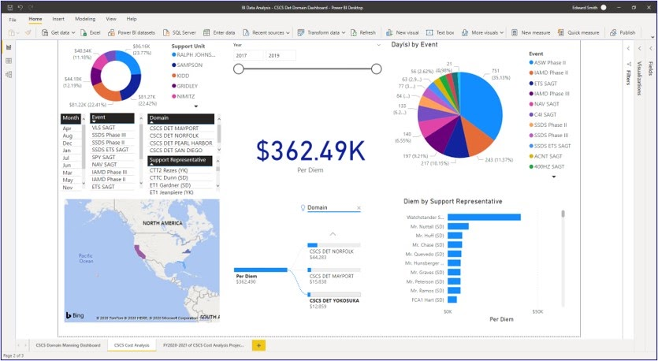</a><br>
      <sub><b>Per Diem and Travel Cost Dashboard</b><br>Power BI · DAX KPIs · Bing Maps</sub>
    </td>
    <td width="33%" align="center">
      <a href="power-platform/README.md#3-risk-to-force-training-analysis">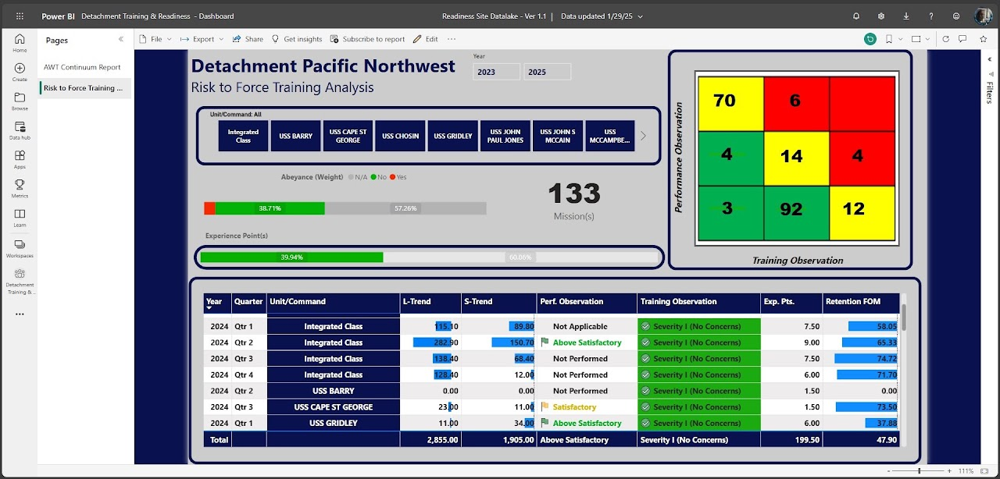</a><br>
      <sub><b>Risk to Force Training Analysis</b><br>Power BI · Risk matrix heat map</sub>
    </td>
    <td width="33%" align="center">
      <a href="power-platform/README.md#9-instructor-eportfolio-summary">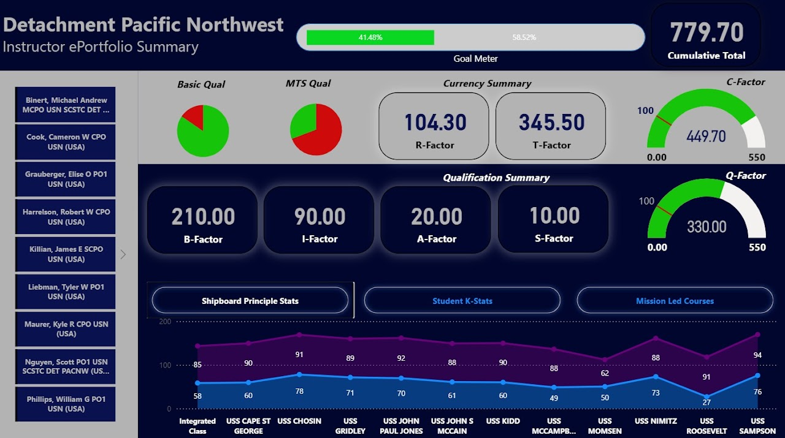</a><br>
      <sub><b>Instructor ePortfolio Summary</b><br>Power BI · Talent analytics</sub>
    </td>
  </tr>
  <tr>
    <td align="center">
      <a href="power-platform/README.md#10-effective-directives-library-app">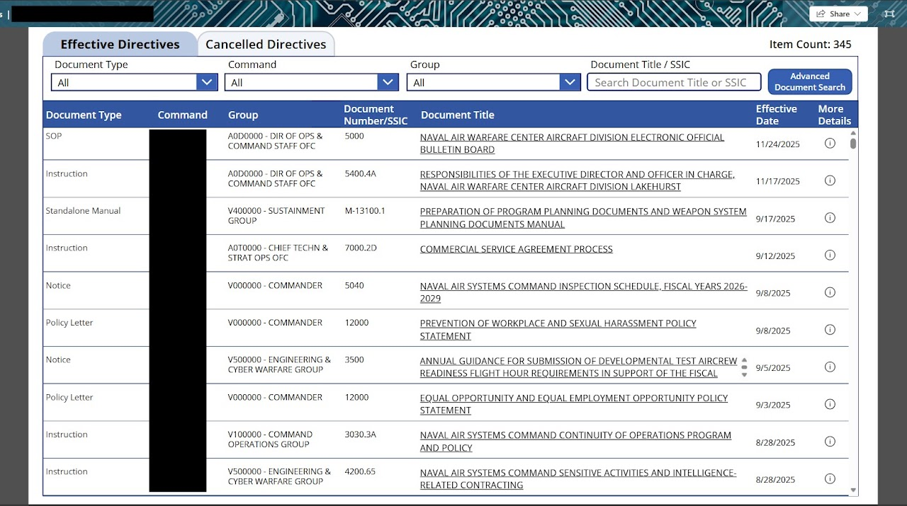</a><br>
      <sub><b>Effective Directives Library App</b><br>Power Apps · SharePoint · Dataverse</sub>
    </td>
    <td align="center">
      <a href="power-platform/README.md#17-end-of-mission-report-automation-flow">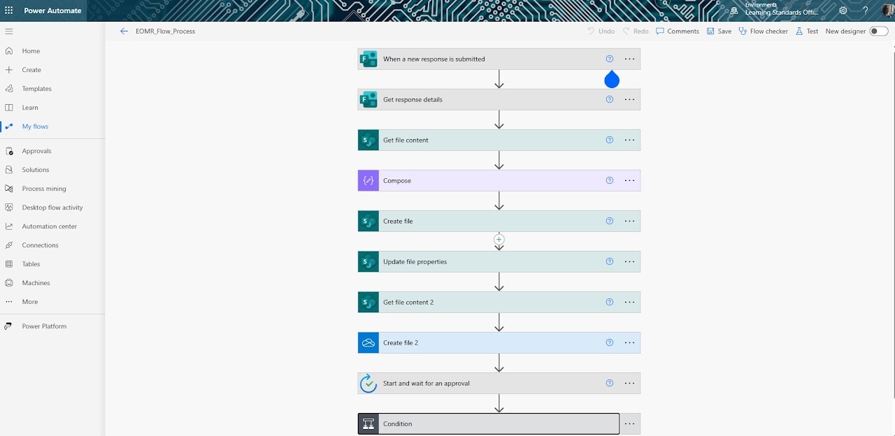</a><br>
      <sub><b>End of Mission Report Automation Flow</b><br>Power Automate · Approvals</sub>
    </td>
    <td align="center">
      <a href="sharepoint-online/README.md#3-training-command-portal">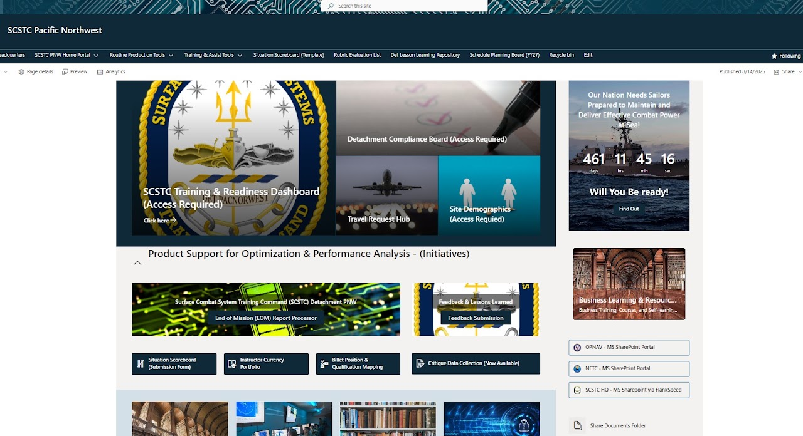</a><br>
      <sub><b>Training Command Portal</b><br>SharePoint Online · Modern site design</sub>
    </td>
  </tr>
</table>

## Skills Matrix

| Domain | Tools and Techniques |
|---|---|
| Business intelligence and visualization | Power BI, DAX-driven KPIs, interactive slicers, risk-matrix heat maps, gauges and progress bars, Bing Maps integration, statistical visuals (mean, median, standard deviation, Z-score, bell curves) |
| Data engineering and modeling | Power Query ETL, data profiling and validation, relational modeling with surrogate and foreign keys, SharePoint-to-datalake pipeline mapping, near real-time refresh |
| Low-code application development | Power Apps (canvas and dashboard apps), SharePoint and Dataverse backends, modular UI for record navigation and inline editing |
| Process automation and governance | Power Automate triggers, conditional branching, multi-repository file management, Teams Approvals integration, audit-ready workflow logging |
| Knowledge and records management | SharePoint Online site design, information architecture, records centers with metadata routing, document libraries, Microsoft Lists with JSON form formatting |
| Collaboration and change management | Microsoft Teams Champion (Flank Speed), channel and tab design, just-in-time training, office hours, Microsoft Bookings administration |
| Analytics and research methods | Statistical analysis, G\*Power, database administration, Lean / Six Sigma / Kaizen continuous improvement |

## Relevant Certifications and Specialized Training

<p align="center">
  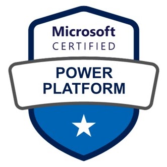
  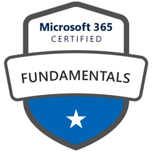
  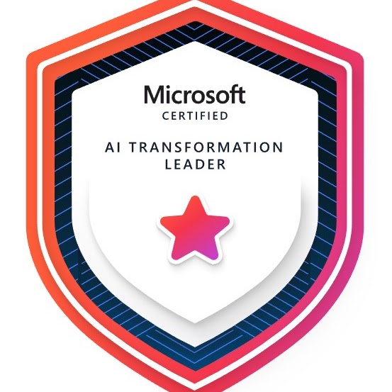
  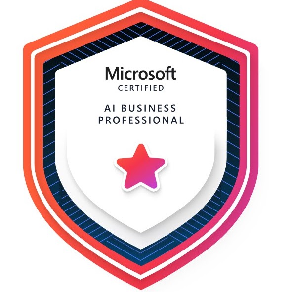
  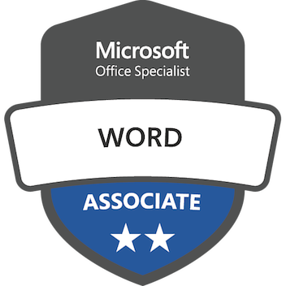
  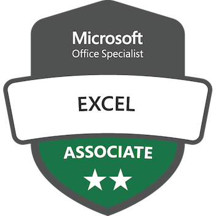
</p>
<p align="center">
  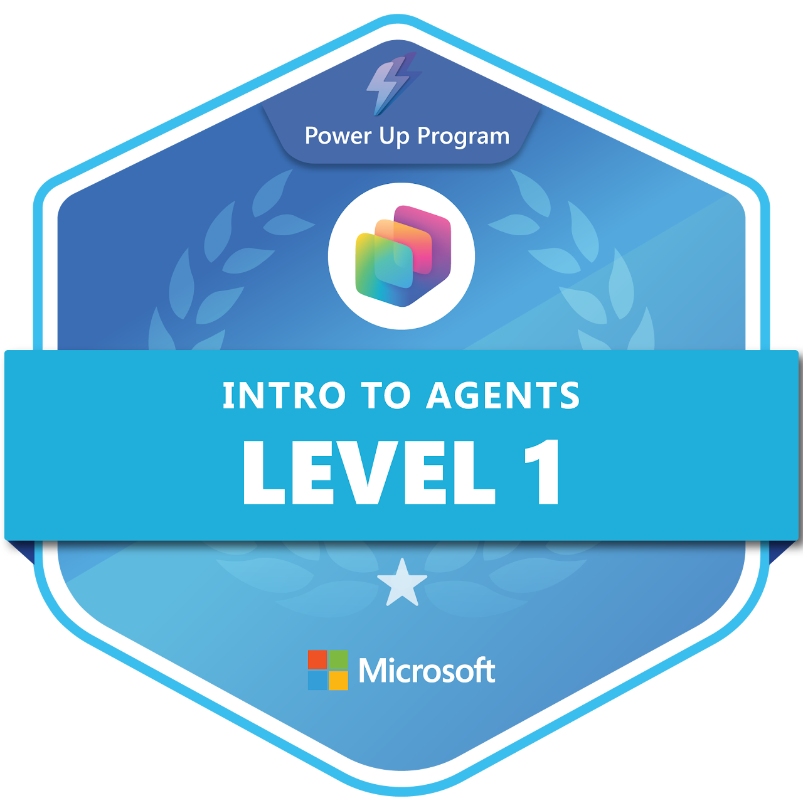
  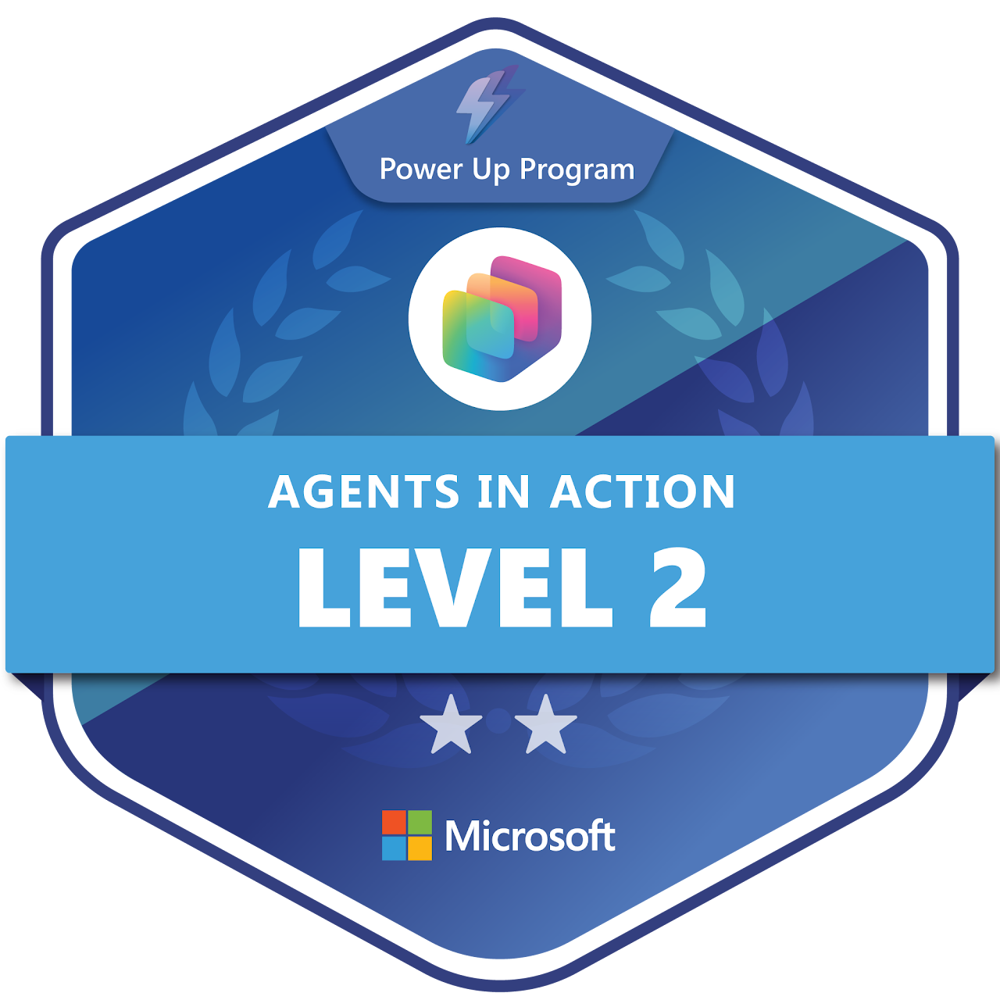
  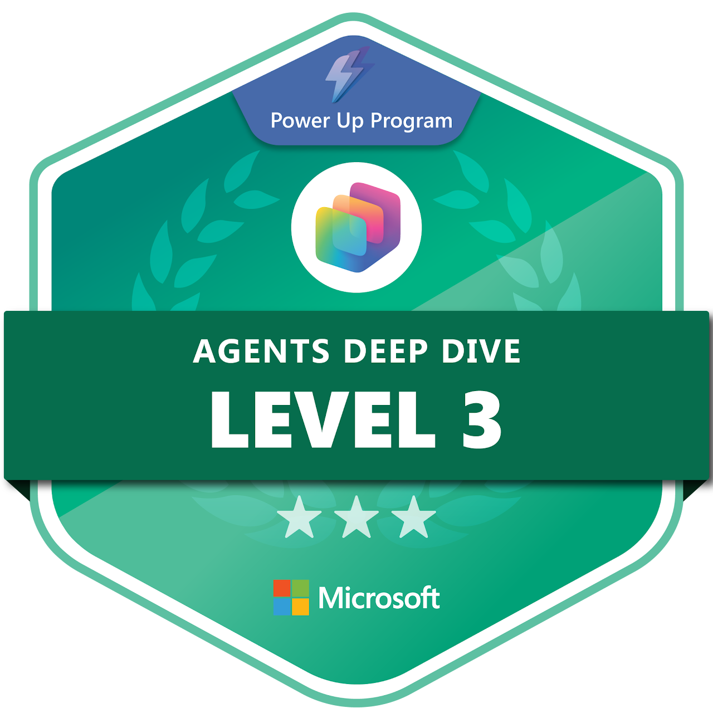
  
  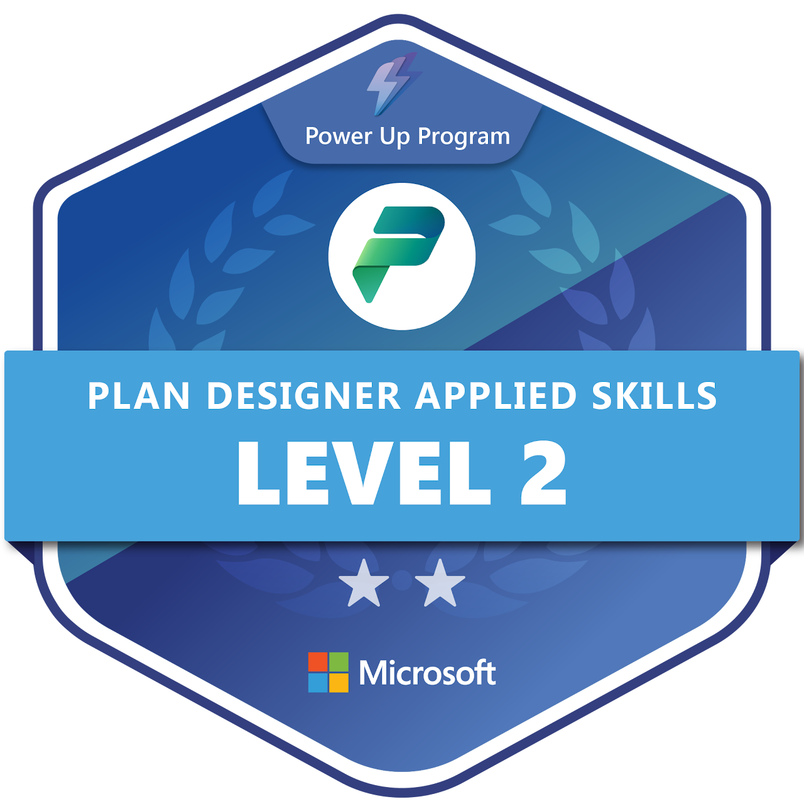
</p>

Full list with descriptions: [Certifications](certifications/README.md). Verified transcript: [Microsoft Learn | Transcripts](https://learn.microsoft.com/en-us/users/smithe46/transcript/d9rkwsl684pqpqz).

## Repository Structure

```text
.
├── README.md                     # This page: background, portfolio overview, skills, certifications
├── PROFILE-README.md             # Short version for a GitHub profile repository (<username>/<username>)
├── PUBLISHING.md                 # How to push this folder to GitHub and keep it updated
├── power-platform/README.md      # 17 Power BI, Power Apps, Power Query, and Power Automate solutions
├── sharepoint-online/README.md   # 7 SharePoint Online site designs
├── microsoft-lists/README.md     # 5 Microsoft Lists solutions
├── microsoft-bookings/README.md  # 3 Microsoft Bookings views
├── microsoft-excel/README.md     # 2 Excel auditing tools
├── microsoft-teams/README.md     # 4 Microsoft Teams works
├── certifications/README.md      # Credential list with badge images
└── assets/                       # Screenshots and badges, organized by section
```

Each solution page follows the same structure used on the original site: **Overview**, **Techniques**, **Challenge addressed**, and **Intended use**.

## Connect

If you'd like to learn more about me and my journey, please visit:

- [LinkedIn](https://www.linkedin.com/in/edward-smith-9820a168)
- [Microsoft Learn profile](https://learn.microsoft.com/en-us/users/smithe46/)
- [Space Studies and Research Academy](https://sites.google.com/view/space-studies-and-research-aca/home)
- [Original portfolio on Google Sites](https://sites.google.com/view/edwardstechportfolio/home)

---

<p align="center"><sub>Content adapted from <a href="https://sites.google.com/view/edwardstechportfolio/home">Edward's Tech Portfolio</a>.</sub></p>

[Back to top](#top)
