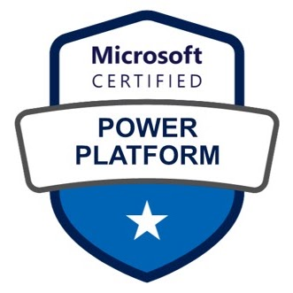
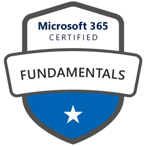
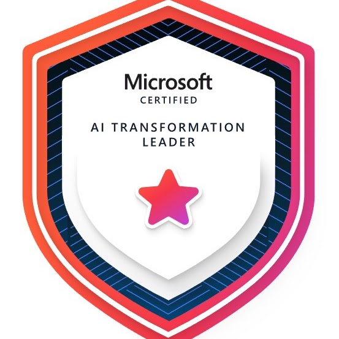
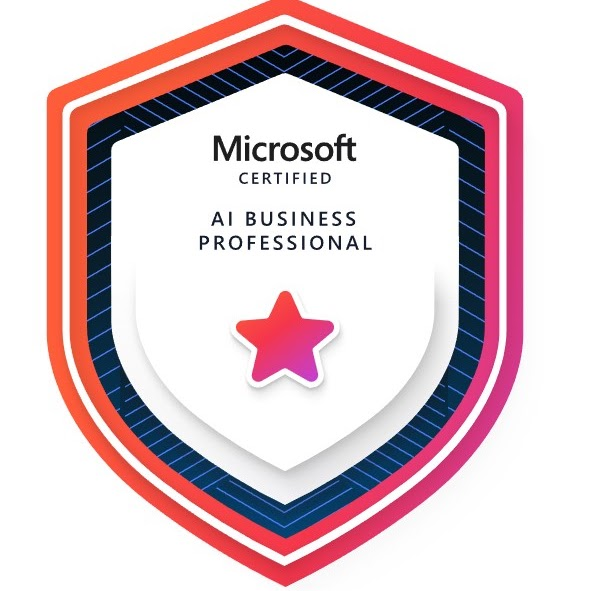
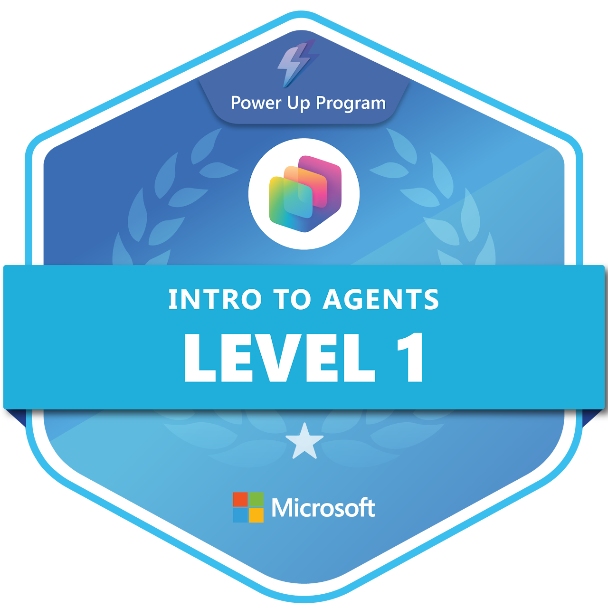
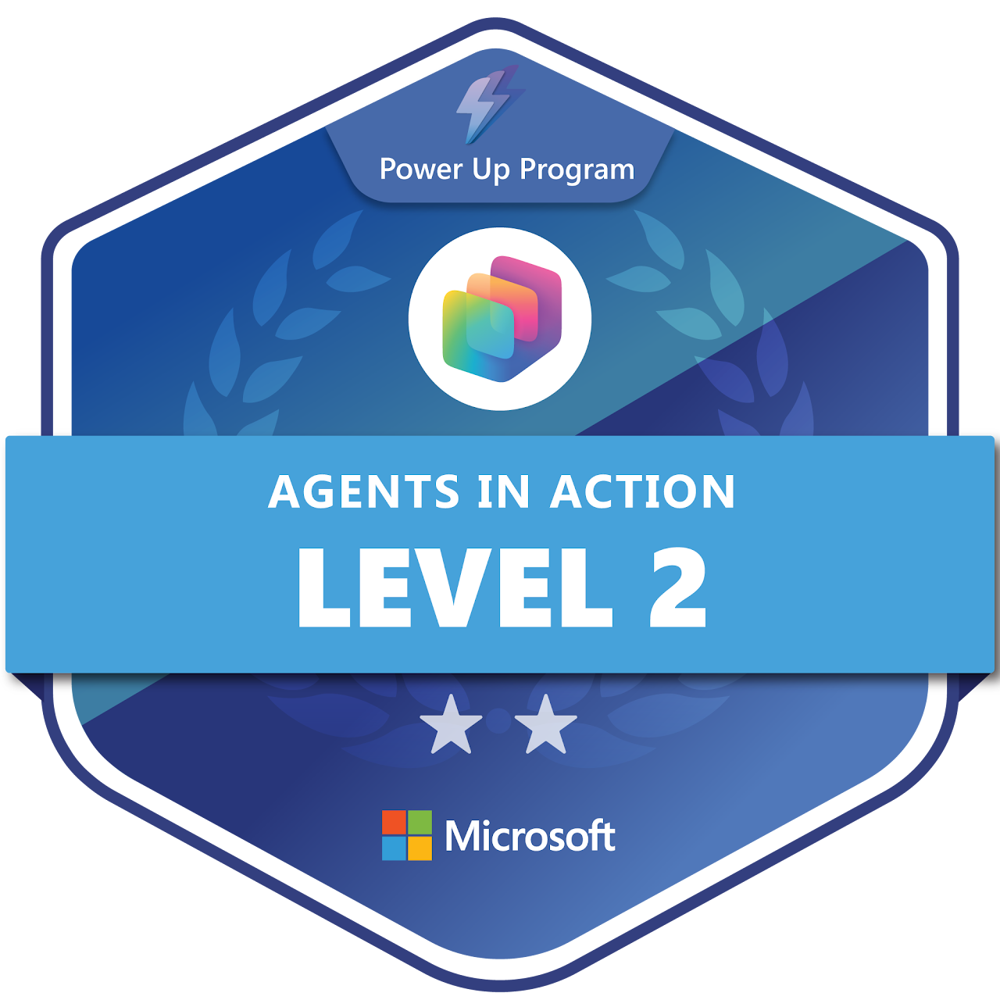
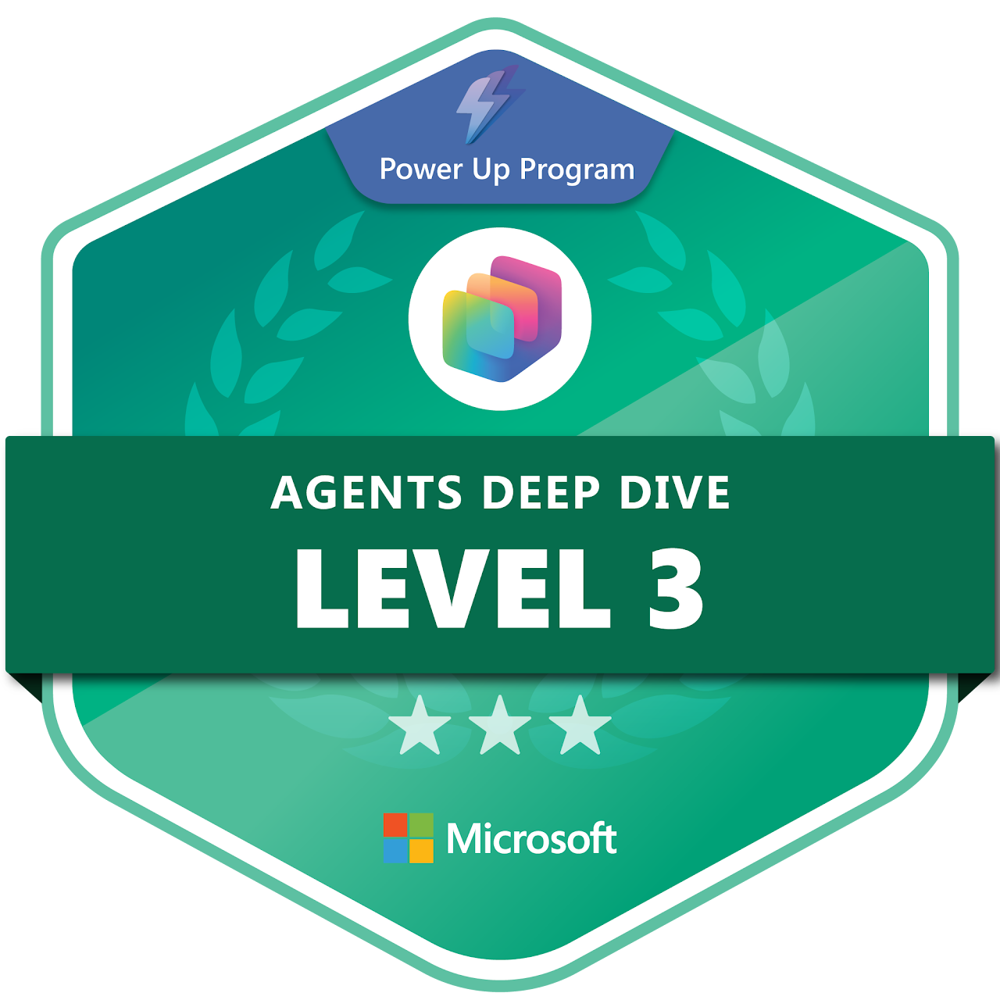

# Relevant Certifications and Specialized Training

[Home](../README.md) · [Power Platform](../power-platform/README.md) · [SharePoint Online](../sharepoint-online/README.md) · [Microsoft Lists](../microsoft-lists/README.md) · [Microsoft Bookings](../microsoft-bookings/README.md) · [Microsoft Excel](../microsoft-excel/README.md) · [Microsoft Teams](../microsoft-teams/README.md) · [Certifications](../certifications/README.md)

Credentials displayed on the original portfolio. Verification is available through the public [Microsoft Learn transcript](https://learn.microsoft.com/en-us/users/smithe46/transcript/d9rkwsl684pqpqz) and [Microsoft Learn profile](https://learn.microsoft.com/en-us/users/smithe46/).

## Microsoft Certified

| Badge | Credential | Focus |
|:---:|---|---|
|  | **Microsoft Certified: Power Platform Fundamentals** | Core capabilities of Power BI, Power Apps, Power Automate, Power Pages, and Dataverse |
|  | **Microsoft 365 Certified: Fundamentals** | Microsoft 365 cloud services, security, compliance, and licensing concepts |
|  | **Microsoft Certified: AI Transformation Leader** | Leading organizational AI adoption and transformation strategy |
|  | **Microsoft Certified: AI Business Professional** | Applying AI to business scenarios and workflows |

## Microsoft Office Specialist

| Badge | Credential | Focus |
|:---:|---|---|
|  | **Microsoft Office Specialist: Word Associate** | Document creation, formatting, and collaboration in Word |
|  | **Microsoft Office Specialist: Excel Associate** | Worksheets, tables, formulas, and charts in Excel |

## Microsoft Power Up Program

| Badge | Credential | Focus |
|:---:|---|---|
|  | **Intro to Agents — Level 1** | Fundamentals of building agents with Microsoft Copilot Studio |
|  | **Agents in Action — Level 2** | Applying agents to practical business scenarios |
|  | **Agents Deep Dive — Level 3** | Advanced agent design, orchestration, and governance |
|  | **Plan Designer Fundamentals — Level 1** | Planning Power Platform solutions with Plan Designer |
|  | **Plan Designer Applied Skills — Level 2** | Applied solution planning and design with Plan Designer |

## Specialized Training and Roles

- **Microsoft Teams Champion, Department of the Navy (Flank Speed)** — local expert and ambassador for Microsoft Teams and Microsoft 365 collaboration tools during the Navy's cloud adoption. See [Microsoft Teams Works](../microsoft-teams/README.md#1-microsoft-teams-champion).
- **Statistical tooling** — G\*Power for power analysis and sample-size planning, alongside DAX and database administration.

Source: [Edward's Tech Portfolio — Home](https://sites.google.com/view/edwardstechportfolio/home)

[Back to top](#top)
