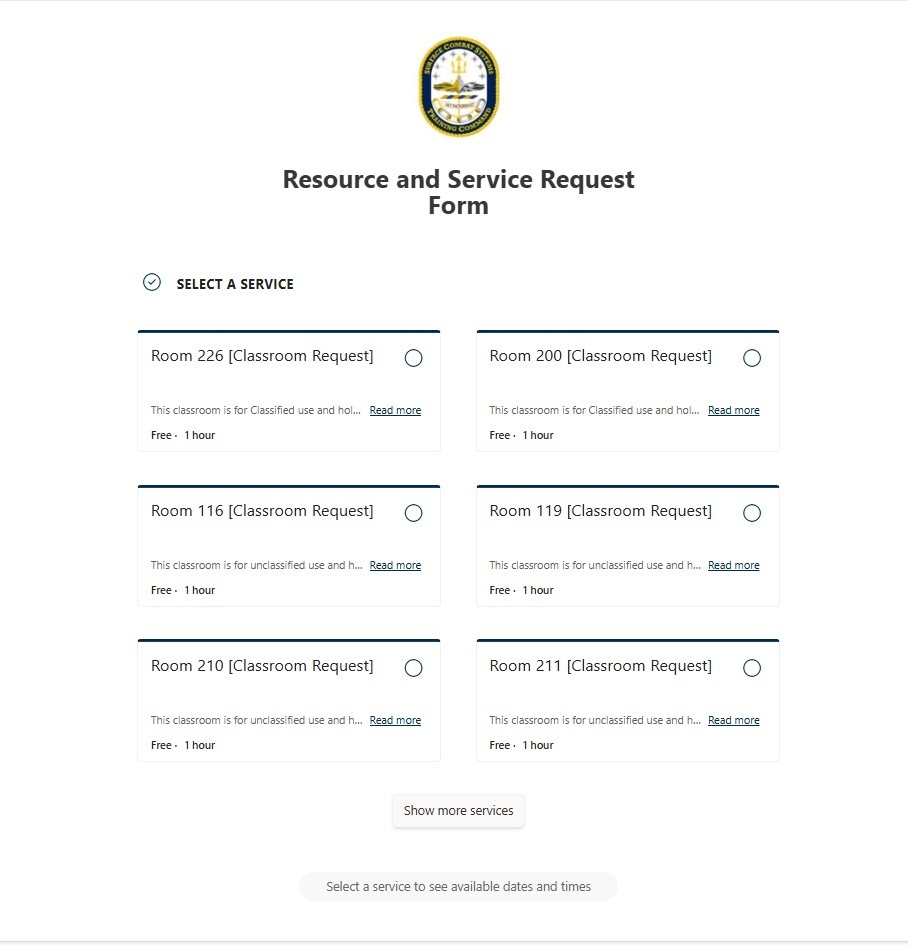
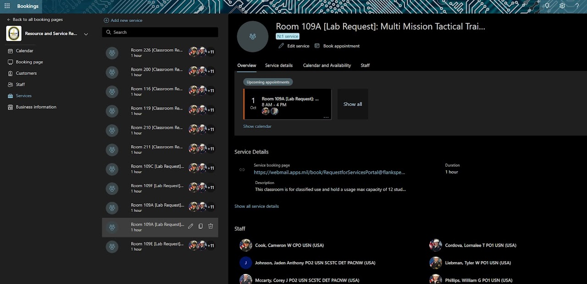
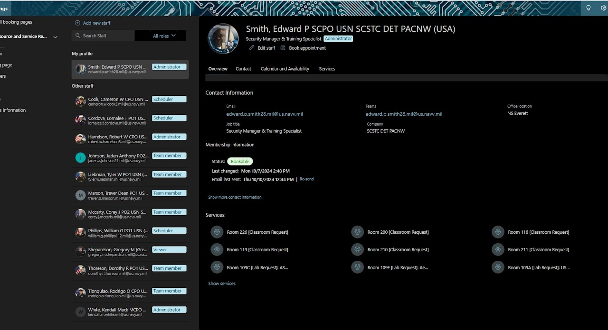

# Microsoft Bookings Works

[Home](../README.md) · [Power Platform](../power-platform/README.md) · [SharePoint Online](../sharepoint-online/README.md) · [Microsoft Lists](../microsoft-lists/README.md) · [Microsoft Bookings](../microsoft-bookings/README.md) · [Microsoft Excel](../microsoft-excel/README.md) · [Microsoft Teams](../microsoft-teams/README.md) · [Certifications](../certifications/README.md)

A classroom and lab reservation system built on Microsoft Bookings, covering the public-facing request form, service configuration, and role-based staff administration for classified and unclassified instructional spaces.

## Contents

1. [Resource and Service Request Form](#1-resource-and-service-request-form)
2. [Service Configuration Console](#2-service-configuration-console)
3. [Staff Roles and Service Assignment](#3-staff-roles-and-service-assignment)

---

### 1. Resource and Service Request Form

**Platform:** Microsoft Bookings (front-end UI)  
**Portfolio label:** Front end UI

**Overview**

Users select from several classroom services each labeled as a one-hour, free resource and tagged for classified or unclassified use. The form is part of a broader reservation system that controls access to on-base instructional spaces.

**Techniques**

- The clean, card-based design suggests implementation with Microsoft Bookings or a custom Power Apps/Forms front end, tied into an Outlook/Exchange calendar for conflict-free scheduling.
- Reflects good resource management and UX design, making it easy for staff to choose appropriate rooms while enabling administrators to track utilization and enforce classification and policy requirements.

**Challenge addressed**

The challenge addressed is that without a standardized digital request form, classroom scheduling can become fragmented, resulting in double bookings, underutilized rooms, and confusion over which spaces are cleared for classified versus unclassified events. Manual coordination via email or spreadsheets also makes it difficult to audit usage or prioritize mission-critical events.

[Back to top](#top)

---

### 2. Service Configuration Console

**Platform:** Microsoft Bookings (administrator view)  
**Portfolio label:** Administrator view

**Overview**

The left panel lists all classroom and lab services, while the main pane displays the configuration for room, including upcoming appointments, service details, and assigned staff. The service booking page URL, description (classified use, max capacity 12 students), and duration (1 hour) are clearly defined.

**Techniques**

- Configuration demonstrates advanced Microsoft Bookings administration, integrated with Azure AD/Exchange to handle staff calendars, email notifications, and role-based access.
- Supports resource governance for classified training spaces, enforcing capacity limits, clear ownership, and auditable appointment records that link to the public-facing request form shown previously.

**Challenge addressed**

The challenge addressed is that managing high-demand classified labs and classrooms requires tight control over booking rules, staff coverage, and capacity; manual calendars or email chains can lead to conflicts, security issues, and unclear accountability. A centralized booking admin console is needed to define services consistently, link them to appropriate staff, and monitor upcoming sessions at a glance.

**Intended use**

- Administrators edit service settings (name, description, duration, buffer times, availability) and manage the staff associated with each room from this interface.
- The “Upcoming appointments” card and calendar view allow quick review of scheduled lab uses, supporting planning and deconfliction.
- Staff lists at the bottom assign specific instructors and coordinators to the service, ensuring that only authorized personnel appear on bookings and receive notifications.

[Back to top](#top)

---

### 3. Staff Roles and Service Assignment

**Platform:** Microsoft Bookings (administrator view)  
**Portfolio label:** Administrator view

**Overview**

The profile pane lists contact information, membership status (bookable), company and office location, and the set of services (rooms and labs) this staff member supports. The left column displays other staff with roles such as Administrator, Scheduler, Team member, and Viewer, giving a complete view of the booking team.

**Techniques**

- Configuration demonstrates role-based access control and workforce mapping within Microsoft Bookings, tightly integrated with Azure AD identities.
- Mature service management and scheduling design, where classroom and lab resources are tied to clearly defined owners and support staff, improving reliability and auditability of the reservation process.

**Challenge addressed**

The challenge addressed is coordinating bookings across many rooms and multiple coordinators can lead to confusion about who owns which resources, who can approve appointments, and who receives notifications. Without clear role and service assignments, double-bookings, missed requests, or gaps in coverage are more likely.

**Intended use**

- Administrators assign and adjust roles (Administrator, Scheduler, Team member, Viewer) and link each staff member to specific services.
- The profile shows which services this individual is bookable for, ensuring that only properly authorized and trained personnel are exposed on the public booking page.
- Contact details and Teams/email addresses support quick coordination when questions arise about a particular reservation or service.

[Back to top](#top)

---

Source: [Edward's Tech Portfolio — Microsoft Bookings Works](https://sites.google.com/view/edwardstechportfolio/microsoft-booking-works)
