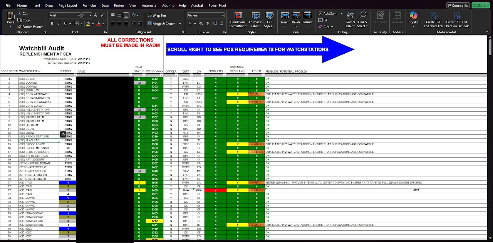
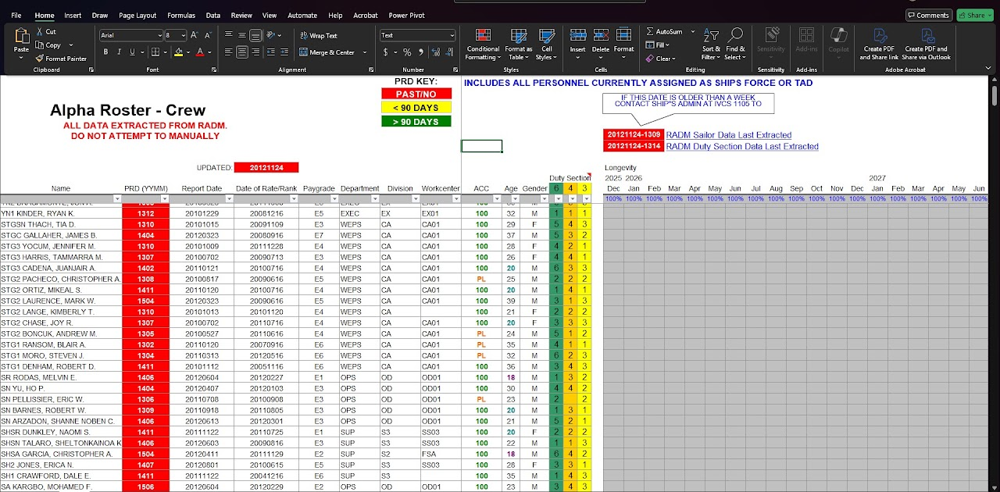

# Microsoft Excel Works

[Home](../README.md) · [Power Platform](../power-platform/README.md) · [SharePoint Online](../sharepoint-online/README.md) · [Microsoft Lists](../microsoft-lists/README.md) · [Microsoft Bookings](../microsoft-bookings/README.md) · [Microsoft Excel](../microsoft-excel/README.md) · [Microsoft Teams](../microsoft-teams/README.md) · [Certifications](../certifications/README.md)

Two Excel auditing tools for shipboard manpower management: a watchbill employment sheet and a controlled alpha roster, both driven by external data connections, structured tables, and conditional formatting.

## Contents

1. [Watchbill Employment Audit Sheet](#1-watchbill-employment-audit-sheet)
2. [Controlled Alpha Roster](#2-controlled-alpha-roster)

---

### 1. Watchbill Employment Audit Sheet

**Platform:** Microsoft Excel  
**Portfolio label:** UI auditing tool I

**Overview**

The sheet lists each sailor with key attributes PRD (projected rotation date), report date, rate/rank, officer flag, paygrade, department, division, workcenter, account code, watch assignment status, and absence information. Summary metrics at the top right, such as CREW COUNT, DUPLICATED, and NOT ASSIGNED, provide an immediate snapshot of manning health.

**Techniques**

- Demonstrates advanced Excel skills: structured tables, conditional formatting, cross-sheet formulas, and data imports from external “RADM Data Processing” files.
- Reflects strong operations analysis and manpower planning capability, translating raw personnel data into an actionable view that supports safe, compliant operations within the organization.

**Challenge addressed**

The challenge addressed is to ensure every required watchstation is filled without overloading individuals or leaving gaps; doing this manually or with fragmented lists can lead to unassigned watches, duplicated assignments, or unnoticed absences. A structured employment sheet is essential for balancing manning, tracking availability, and preparing defensible watchbills.

**Intended use**

- Departmental or ship’s office staff enter and update sailor data, using conditional formatting to highlight key statuses and readiness levels.
- The “Number of Watchstations Assigned” and “Absent (Leave/TAD)” columns help planners see where individuals are not assigned or unavailable, feeding into watchbill generation.
- Multiple worksheet tabs (Watchbill, Watchbill Employment, RADM Absence Data) indicate an integrated system that draws on external data and feeds downstream duty schedules.

[Back to top](#top)

---

### 2. Controlled Alpha Roster

**Platform:** Microsoft Excel  
**Portfolio label:** UI auditing tool II

**Overview**

The sheet lists each personnel with PRD, report date, rate/rank date, paygrade, department, division, workcenter, account code, age, gender, and duty section assignment, along with future longevity tracking by month and year. A PRD Key at the top uses red/yellow/green to distinguish past-due PRDs, within 90 days, and beyond 90 days, while header notes emphasize that all data is system-extracted and should not be edited manually.

**Techniques**

- Demonstrate data integration and control: importing from enterprise systems, locking manual edits, and using clear visual keys to guide users.
- Highlights advanced Excel modeling skills (external data connections, conditional formatting, structured tables) applied to real-world organization manpower and readiness management.

**Challenge addressed**

The challenge addressed is maintaining an accurate, up-to-date view of all personnel assigned to a ship (including TAD) is critical for manpower planning, advancement, and watch section balancing; inconsistent or manually edited rosters can quickly drift from official systems, causing manning errors and readiness blind spots. A controlled, automatically populated alpha roster provides a single source of truth aligned with RADM.

**Intended use**

- Admin staff refresh the data from RADM using the links shown (RADM Sailor Data Last Extracted, RADM Duty Section Data Last Extracted) and verify that the “Updated” date is current.
- Conditional formatting instantly highlights PRD risk bands and account-code status, supporting detailing conversations and retention planning.
- Duty section columns (6/4/3) and the longevity grid support downstream tools like watchbill employment sheets, ensuring each duty section remains balanced over time.

[Back to top](#top)

---

Source: [Edward's Tech Portfolio — Microsoft Excel Works](https://sites.google.com/view/edwardstechportfolio/microsoft-excel-works)
