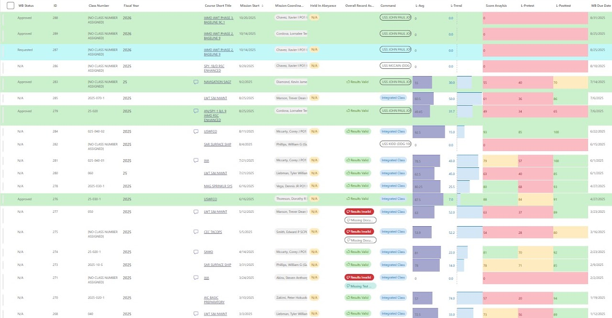
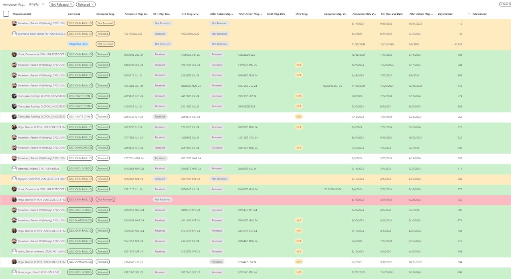
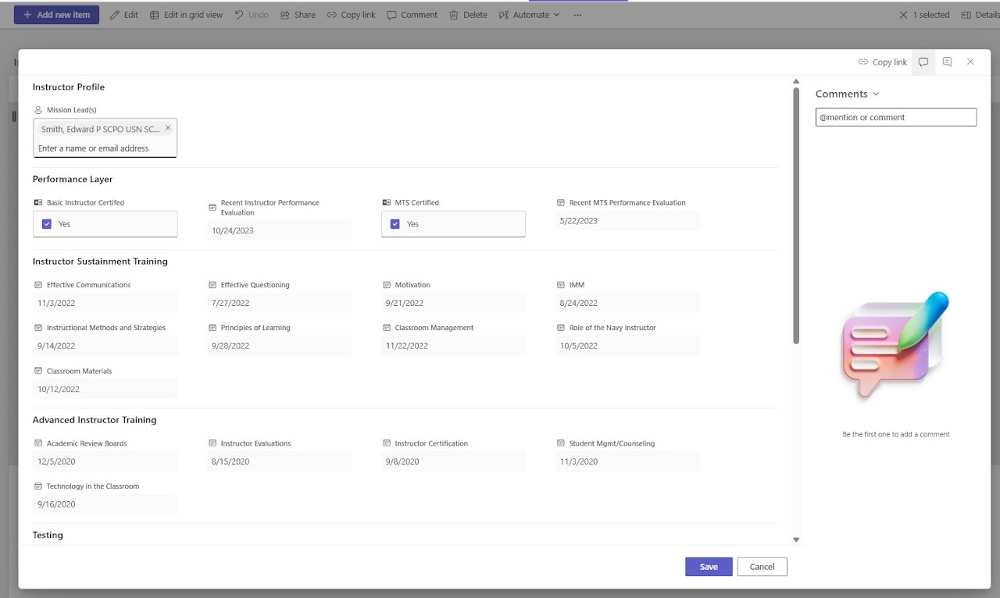
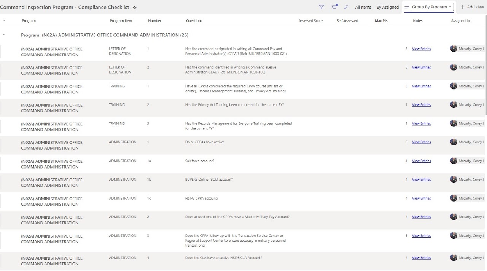
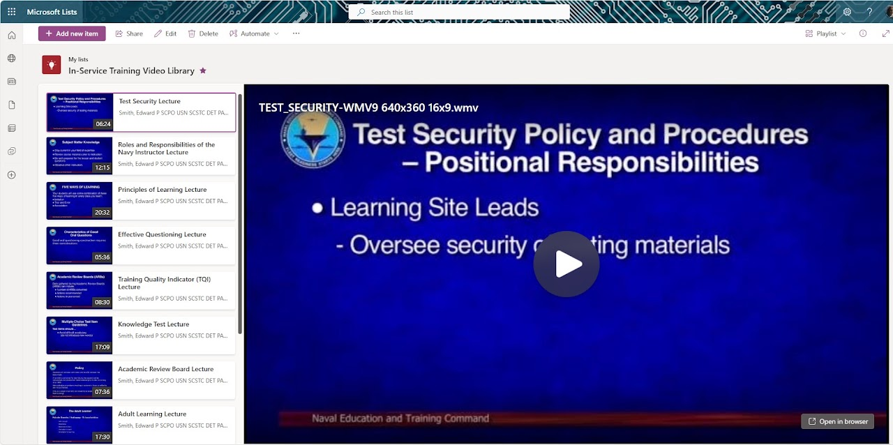

# Microsoft Lists Works

[Home](../README.md) · [Power Platform](../power-platform/README.md) · [SharePoint Online](../sharepoint-online/README.md) · [Microsoft Lists](../microsoft-lists/README.md) · [Microsoft Bookings](../microsoft-bookings/README.md) · [Microsoft Excel](../microsoft-excel/README.md) · [Microsoft Teams](../microsoft-teams/README.md) · [Certifications](../certifications/README.md)

Five Microsoft Lists solutions that give coordinators, training managers, and inspectors structured, filterable, and auditable views of mission progress, communications, instructor development, inspection readiness, and training media.

## Contents

1. [Mission Class Scoreboard](#1-mission-class-scoreboard)
2. [Message and Announcement Tracker](#2-message-and-announcement-tracker)
3. [Instructor Profile Form (JSON formatting)](#3-instructor-profile-form-json-formatting)
4. [Command Inspection Compliance Checklist](#4-command-inspection-compliance-checklist)
5. [In-Service Training Video Library](#5-in-service-training-video-library)

---

### 1. Mission Class Scoreboard

**Platform:** Microsoft Lists (grid view)  
**Portfolio label:** Spreadsheet view

**Overview**

The scoreboard manages and monitors progress for different training or mission classes across fiscal years, commands, and coordinators. It brings together approval status, mission dates, score progress (pre-test, post-test), and validation or documentation requirements into a single visual platform.

**Techniques**

- The format is a sophisticated spreadsheet or project management platform that supports custom views, automation, and collaboration.
- Advanced filtering (compact, calendar, summary views) indicates multi-dimensional project tracking and reporting are enabled.
- Integration with assignment and record validation methods offers an ongoing feedback loop that surfaces risks immediately.

**Challenge addressed**

The main challenge addressed by this tool is the need for a clear, real-time overview of multiple ongoing training classes or missions. Problems include documentation gaps, test result invalidity, and coordination lapses, all of which could delay mission completion or impact readiness.

**Intended use**

- Help project managers or coordinators track approval status, progress scores, and documentation status for each class.
- Quickly highlight where intervention is required (e.g., missing documents, invalid results, or unassigned coordinators).
- Provide stakeholders a transparent, at-a-glance overview of project health and readiness across multiple concurrent missions.

[Back to top](#top)

---

### 2. Message and Announcement Tracker

**Platform:** Microsoft Lists (grid view)  
**Portfolio label:** Spreadsheet view

**Overview**

This tracker is used to monitor the progress and communication status of different announcements and operational messages managed by multiple mission leads and commands. It covers whether messages are released, received, or pending, alongside dates for due actions and calculations for days remaining.

**Techniques**

- The structure used for advanced collaborative project management tool with customizable columns and automation, ideal for multi-project messaging workflows.
- Automated calculations (days remaining, overdue) leverage best practices in digital PM for deadline management.
- Integrated command and stakeholder assignment fields ensure accountability and traceability throughout communications.

**Challenge addressed**

The main issues addressed include fragmented communication, missed deadlines, and gaps in coordination between mission leads and their teams. Problems such as not released messages, missing received status, or highly negative “days remain” values can indicate bottlenecks, overdue actions, and ineffective workflows.

**Intended use**

- An immediate summary of which critical communications have not been sent or acknowledged.
- Days remaining calculations to flag overdue items.
- A quick reference for project managers to follow up with stakeholders, address delays, and maintain timely delivery across projects or training cycles.

[Back to top](#top)

---

### 3. Instructor Profile Form (JSON formatting)

**Platform:** Microsoft Lists (custom form)  
**Portfolio label:** Form view using JSON

**Overview**

The form records a specific instructor (selected in the Mission Lead(s) field) and tracks multiple layers of performance and training, including basic instructor certification, Master Training Specialist (MTS) certification, and the dates of recent performance evaluations. It also captures sustainment and advanced training events such as Effective Communications, Questioning, Classroom Management, Academic Review Boards, and Technology in the Classroom.

**Techniques**

- Built on Microsoft Lists/SharePoint, this tracker demonstrates list design, custom columns, and form customization tailored to instructor development workflows.
- Portfolio-level analytics when connected to Power BI, enabling dashboards that roll up certification and sustainment status across all instructors, as seen elsewhere in the portfolio.
- Structure aligns with best practices in talent management and compliance, ensuring every instructor’s qualifications and training history are accurate, auditable, and easy to review for inspections or accreditation.

**Challenge addressed**

The challenge addressed is that instructor programs must prove that personnel are certified, current, and receiving periodic sustainment training; tracking this in spreadsheets or paper files creates gaps, expired certifications, and audit risk. Without a centralized, date-driven tracker, leaders cannot easily see who is overdue, what courses are missing, or how instructor readiness compares across the detachment.

**Intended use**

- Training managers or knowledge managers open an instructor’s record and update checkboxes (e.g., Basic Instructor Certified, MTS Certified) and completion dates for each sustainment or advanced training topic.
- The form provides a single timeline for all key events initial certification, sustainment courses, and evaluations supporting readiness reviews and inspection evidence.
- Comments on the right enable collaboration, allowing supervisors to annotate performance notes or follow-up actions tied directly to the instructor’s profile.

[Back to top](#top)

---

### 4. Command Inspection Compliance Checklist

**Platform:** Microsoft Lists (grouped view)  
**Portfolio label:** Spreadsheet view

**Overview**

The list is grouped by program, with each row representing a specific checklist item (e.g., letters of designation, required trainings, and administrative accounts) and its corresponding question and point value. Columns capture assessed score, self-assessment, maximum points, notes, and the assigned responsible person, enabling structured preparation for formal inspections.

**Techniques**

- The checklist is implemented in SharePoint / Microsoft Lists, demonstrating list design, column configuration, grouping, and role-based access suited for compliance workflows.
- Reflects best practices in governance and risk management, where structured questions are mapped to requirements and other directives, scored, and tied to responsible parties for continuous readiness.

**Challenge addressed**

The challenge addressed is that organizations often struggle to keep track of numerous detailed inspection requirements spanning designations, mandatory training, and account management, which can lead to missed items and inspection discrepancies. A static spreadsheet or paper checklist makes it difficult to assign ownership, monitor progress, and roll up scores for leadership.

**Intended use**

- Inspectors and program owners filter, group, or sort items (e.g., by Program Item, Assigned To) to focus on specific requirement sets such as training or administration.
- Each checklist question is assigned to a named individual; they update self-assessed scores and notes before formal inspection, supporting accountability and pre-inspection remediation.
- Links like View Entries provide access to supporting evidence or detailed records tied to each requirement, strengthening audit trails.

[Back to top](#top)

---

### 5. In-Service Training Video Library

**Platform:** Microsoft Lists (playlist view)  
**Portfolio label:** Video playlist view

**Overview**

The library is used within the organization to provide easy, on-demand access to video training resources for instructors and staff, supporting continuous in-service training (IST) and compliance requirements.

**Techniques**

- Microsoft Lists provides seamless integration with SharePoint, Teams, and OneDrive, making video management part of the broader knowledge workflow.
- On-demand, streaming video replaces static or paper-based training, advancing digital transformation.
- Built-in features for playlisting, sharing, and automation support robust, scalable training program management and reporting.

**Challenge addressed**

The challenge addressed is that without a centralized, digital repository, important training videos can be forgotten, inconsistently accessed, or lost due to personnel turnover, undermining both compliance and best-practice dissemination. Manual delivery of training materials is inefficient and creates tracking difficulties for training managers.

**Intended use**

- To aggregate all essential IST video content in a single, searchable platform, ensuring smooth onboarding and ongoing learning.
- To allow instructors and staff to self-pace their development and repeat training as needed using a familiar, accessible interface.
- To support training managers in curating, updating, and tracking learning resources for diverse staff requirements.

[Back to top](#top)

---

Source: [Edward's Tech Portfolio — Microsoft Lists Works](https://sites.google.com/view/edwardstechportfolio/microsoft-list-works)
