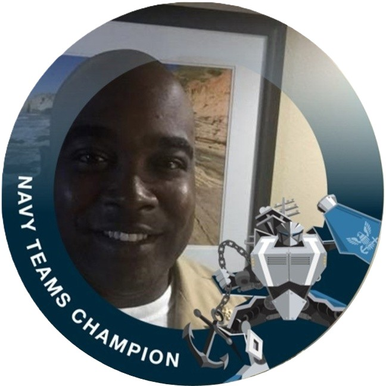
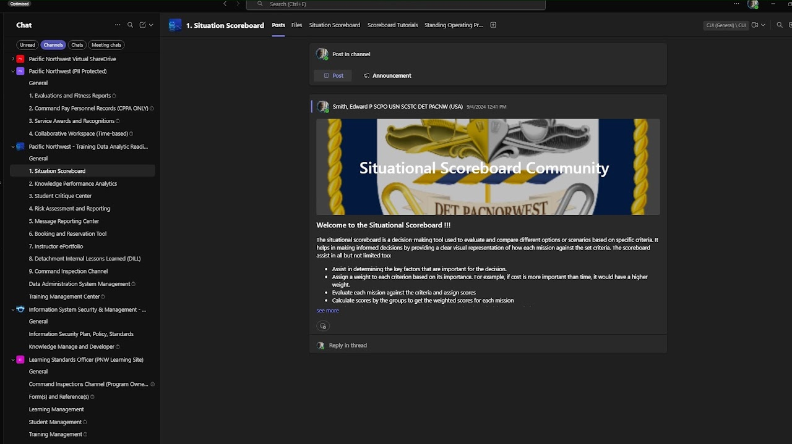
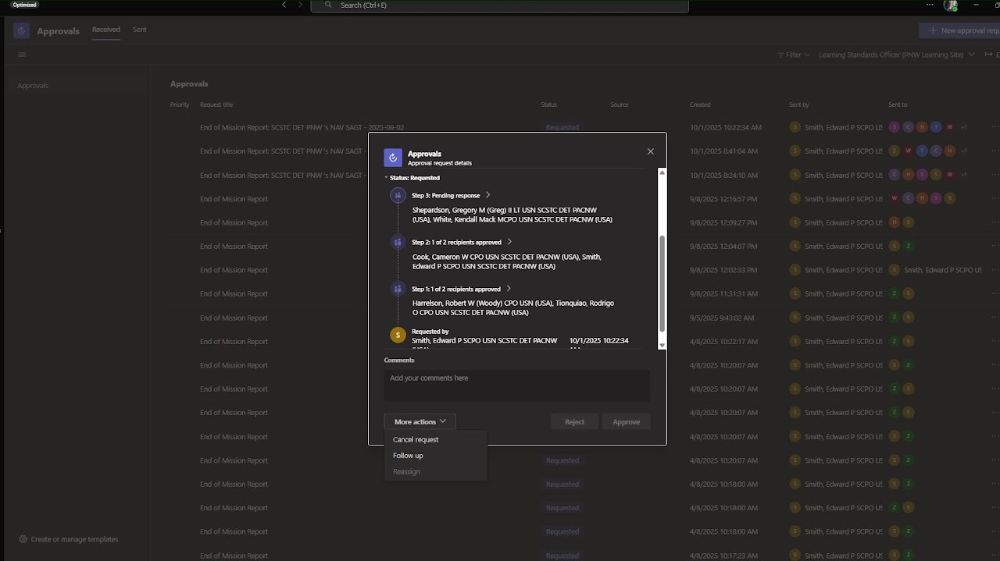
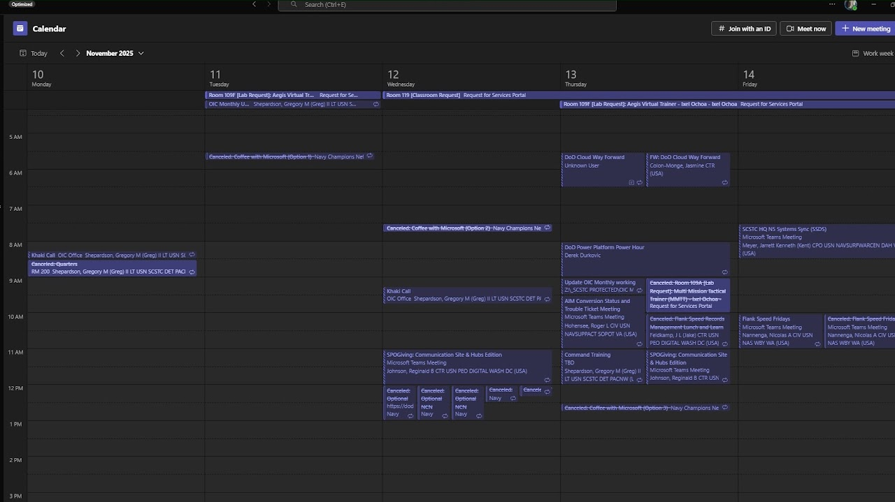

# Microsoft Teams Works

[Home](../README.md) · [Power Platform](../power-platform/README.md) · [SharePoint Online](../sharepoint-online/README.md) · [Microsoft Lists](../microsoft-lists/README.md) · [Microsoft Bookings](../microsoft-bookings/README.md) · [Microsoft Excel](../microsoft-excel/README.md) · [Microsoft Teams](../microsoft-teams/README.md) · [Certifications](../certifications/README.md)

A Microsoft Teams Champion is a Department of the Navy employee who serves as a local expert and ambassador for Microsoft Teams and related Microsoft 365 tools during the Navy's Flank Speed cloud adoption. This section covers Microsoft Teams adoption leadership and solution design during the Navy's Flank Speed cloud migration: the Teams Champion role, an analytics community channel, Power Automate-backed approvals, and unified scheduling.

## Contents

1. [Microsoft Teams Champion](#1-microsoft-teams-champion)
2. [Situation Scoreboard Channel and Forum](#2-situation-scoreboard-channel-and-forum)
3. [End of Mission Report Approvals](#3-end-of-mission-report-approvals)
4. [Unified Scheduling Calendar](#4-unified-scheduling-calendar)

---

### 1. Microsoft Teams Champion

**Platform:** Microsoft Teams (Flank Speed)  
**Portfolio label:** MS Teams Champion

**Overview**

Designated as a DoW Navy Microsoft Teams Champion, led frontline adoption of secure M365 collaboration tools across Flank Speed by coaching peers, modeling best practices, and serving as the first line of support for Teams usage. Drove engagement by running just-in-time trainings, office hours, and scenario-based demonstrations that helped Sailors, Marines, and civilians transition from email-centric workflows to channel-based collaboration, chat, and meetings. Acted as a trusted bridge between end users and IT by collecting feedback, surfacing change impacts, and influencing configuration decisions so Teams and related apps better aligned with mission requirements and zero-trust security standards.

[Back to top](#top)

---

### 2. Situation Scoreboard Channel and Forum

**Platform:** Microsoft Teams (channels and tabs)  
**Portfolio label:** MS Teams (channel and forum)

**Overview**

The channel “Situation Scoreboard” sits inside a broader Teams workspace that hosts multiple analytics and governance channels, including Knowledge Performance Analytics, Student Critique Center, Risk Assessment and Reporting, and Booking and Reservation Tool. The highlighted post is a welcome announcement explaining the purpose and use of the situational scoreboard.

**Techniques**

- Setup demonstrates Teams-based collaboration and governance for analytics solutions, using channels, tabs, and announcements to drive adoption and sustainment.
- Strong change management and knowledge-sharing practices, ensuring the Situational Scoreboard is not just a dashboard but a supported community of practice for data-informed decision making.

**Challenge addressed**

The challenge addressed is that cross-functional teams often struggle to understand new analytical tools and how they fit into decision-making processes; without clear onboarding and a shared space for discussion, dashboards like the Situation Scoreboard can be underused or misinterpreted. A dedicated Teams community helps centralize communication, training materials, and feedback around the tool.

**Intended use**

- The welcome message defines the situational scoreboard as a decision-making tool for evaluating and comparing missions against weighted criteria, listing steps such as identifying key factors, assigning weights, scoring missions, and calculating weighted scores.
- Channel tabs (Files, Situation Scoreboard, Scoreboard Tutorials, Standing Operating Procedures) provide direct access to reference documents, the live app, and training resources.
- Users can reply in-thread to ask questions, share lessons learned, or propose changes to scoring criteria, creating a living knowledge base around the scoreboard methodology.

[Back to top](#top)

---

### 3. End of Mission Report Approvals

**Platform:** Microsoft Teams Approvals + Power Automate  
**Portfolio label:** MS Teams (approval)

**Overview**

The central dialog displays the approval history and current status for a specific End of Mission Report, including each approval step, approvers’ names, and timestamps. The background list shows numerous End of Mission Report requests with statuses such as Requested, along with who created and who received each request.

**Techniques**

- Solution demonstrates Teams Approvals integration with Power Automate, using adaptive cards and workflow logic to orchestrate multi-recipient approvals.
- Strong governance and process automation skills, embedding structured approval flows directly where staff already collaborate, thereby tightening compliance and reducing cycle time for critical mission documentation.

**Challenge addressed**

The challenge addressed reporting requires formal review by multiple leaders; handling this by email or paper can cause lost requests, unclear accountability, and slow closure of missions. A centralized approvals dashboard is essential to know exactly where each report sits in the process and who must act next.

**Intended use**

- Approvers see a step-by-step visual flow (e.g., “Step 3: Pending response,” “Step 2: 1 of 2 recipients approved”) indicating progress through the approval chain.
- From the More actions menu, approvers can cancel, follow up, or reassign the request, while the comment box supports documented feedback tied to the approval record.
- The overall Approvals tab lets the Learning Standards Officer or Knowledge Manager filter by Received/Sent to manage workload and ensure no report stalls.

[Back to top](#top)

---

### 4. Unified Scheduling Calendar

**Platform:** Microsoft Teams + Outlook + Bookings  
**Portfolio label:** MS Teams (scheduler management)

**Overview**

The calendar includes recurring events such as lab requests and multiple Microsoft Teams meetings related to cloud, training, and systems sync. It reflects the operational tempo of an organization that must coordinate instructors, facilities, and external partners across many overlapping events.

**Techniques**

- Calendar demonstrates tight integration between Microsoft Teams, Outlook, and Bookings, where reservations and online meetings surface in one unified schedule.
- Portfolio-level time and resource management, using modern collaboration tools to orchestrate classroom use, virtual training, and decision forums in a complex Navy training environment.

**Challenge addressed**

The challenge addressed is that high meeting and training density increases the risk of conflicts, over-booking of classified labs/classrooms, and missed coordination if scheduling is handled informally. A centralized, shared calendar is crucial for visibility into resource bookings and leadership commitments, supporting efficient time and facility management.

**Intended use**

- Users rely on the calendar to confirm classroom/lab reservations created through the booking portal and Bookings services, ensuring resources are deconflicted.
- Leadership and staff schedule coordination sessions so that key stakeholders can prioritize attendance around existing training obligations.
- The work-week view helps planners scan for open blocks or overloads, adjust timings, and manage their own availability with awareness of broader team commitments.

[Back to top](#top)

---

Source: [Edward's Tech Portfolio — Microsoft Teams Works](https://sites.google.com/view/edwardstechportfolio/microsoft-teams-works)
