

# Power Platform Works

[Home](../README.md) · [Power Platform](../power-platform/README.md) · [SharePoint Online](../sharepoint-online/README.md) · [Microsoft Lists](../microsoft-lists/README.md) · [Microsoft Bookings](../microsoft-bookings/README.md) · [Microsoft Excel](../microsoft-excel/README.md) · [Microsoft Teams](../microsoft-teams/README.md) · [Certifications](../certifications/README.md)

Seventeen Power BI, Power Apps, Power Query, and Power Automate solutions built to turn U.S. Navy training, readiness, compliance, and personnel data into decision-ready intelligence. Each entry documents the solution overview, the techniques applied, the operational challenge addressed, and the intended use.

## Contents

1. [Per Diem and Travel Cost Dashboard](#1-per-diem-and-travel-cost-dashboard)
2. [Knowledge-Based Performance Analysis](#2-knowledge-based-performance-analysis)
3. [Risk to Force Training Analysis](#3-risk-to-force-training-analysis)
4. [Student Critique Dashboard](#4-student-critique-dashboard)
5. [AWT Continuum End of Mission Report Board](#5-awt-continuum-end-of-mission-report-board)
6. [Message Transmittal Summary](#6-message-transmittal-summary)
7. [AWT Continuum Status Board](#7-awt-continuum-status-board)
8. [Situation Scoreboard Records App](#8-situation-scoreboard-records-app)
9. [Instructor ePortfolio Summary](#9-instructor-eportfolio-summary)
10. [Effective Directives Library App](#10-effective-directives-library-app)
11. [Test Analysis Sandbox](#11-test-analysis-sandbox)
12. [Training and Readiness Data Pipeline Map](#12-training-and-readiness-data-pipeline-map)
13. [Mission Training Data ETL](#13-mission-training-data-etl)
14. [Training Intelligence Data Model](#14-training-intelligence-data-model)
15. [Demographic Summary Dashboard](#15-demographic-summary-dashboard)
16. [Command Inspection Compliance Board](#16-command-inspection-compliance-board)
17. [End of Mission Report Automation Flow](#17-end-of-mission-report-automation-flow)

---

### 1. Per Diem and Travel Cost Dashboard

**Platform:** Power BI  
**Portfolio label:** Power BI (financial)

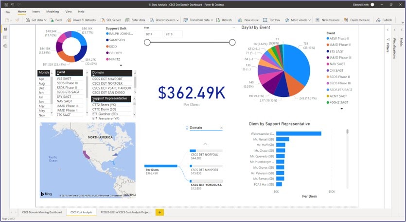

**Overview**

The dashboard aggregates per diem spending (centered on a large $362.49K KPI) and slices it by event type, support unit, domain, and support representative. Visuals include donut and pie charts, bar charts, a time/slider filter, and a Bing map showing geographic distribution of events.

**Techniques**

- The report demonstrates advanced Power BI development skills: multi-visual layout, interactive slicers, integration with Bing Maps, and DAX-driven KPIs.
- Exemplifies data-driven cost management and operational analytics, turning raw travel records into an actionable tool for budget oversight and decision-making in a complex training environment.

**Challenge addressed**

Key issues addressed: without a consolidated analytic view, travel and per diem costs can be scattered across systems, making it difficult for leadership to identify high-cost events, outliers among support reps, or trends over time. This risks overspending, budgeting surprises, and missed opportunities to optimize travel planning.

**Intended use**

- Users filter by fiscal year range, event type, domain, or specific support representative to see how per diem costs and event days shift under different conditions.
- The “Per Diem by Support Representative” bar chart highlights individuals with the highest cost exposure, enabling targeted reviews or best-practice sharing.
- The event pie chart and days-by-event breakdown show which training phases drive the most travel days and associated costs.

[Back to top](#top)

---

### 2. Knowledge-Based Performance Analysis

**Platform:** Power BI  
**Portfolio label:** Power BI (external performance)

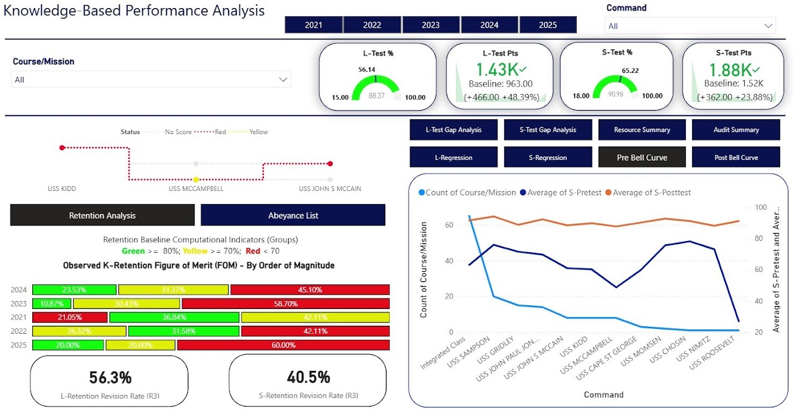

**Overview**

The tool aggregates and visualizes retention rates, test score metrics, and revision rates for a fleet training detachment. The context is ongoing measurement and improvement of personnel knowledge, readiness, and training effectiveness.

**Techniques**

Statistical indicators such as percent, points, and change versus baseline allow quick quantitative portfolio analysis. Retention revision rates (R3) offer a longitudinal view of instructional effectiveness. Interactive breakdowns by commands, years, or specific courses improve root-cause analysis and resource prioritization. The dashboard interface of advanced Power BI features customizable views and integrated audit support.

**Challenge addressed**

Key issues addressed include low retention rates, knowledge attrition over time, and variable training impact across commands. Without regular, quantified analysis, hidden performance gaps and inefficient practices persist, undermining long-term mission success.

**Intended use**

- To benchmark annual and command-specific retention and knowledge metrics, flagging issues needing targeted intervention.
- To enable leaders and trainers to compare performance, guide instructional changes, and track progress over time.
- To visualize gaps and surface trends for informed, actionable portfolio management decisions.

[Back to top](#top)

---

### 3. Risk to Force Training Analysis

**Platform:** Power BI  
**Portfolio label:** Power BI (risk monitor)

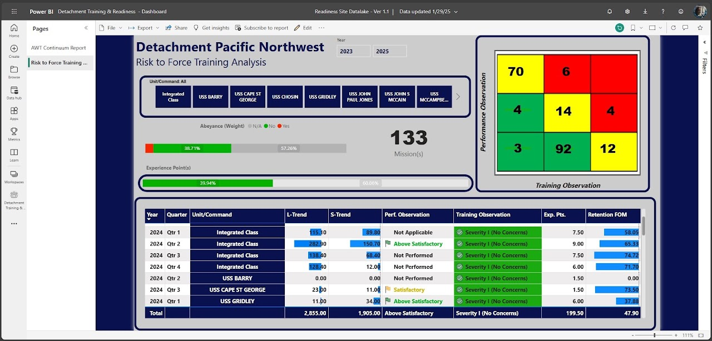

**Overview**

The dashboard consolidates risk metrics, performance, and training observations across various commands and fiscal years. It visualizes mission completion rates, abeyance weights, experience points, and retention figures to assess training effectiveness and areas of concern.

**Techniques**

Risk matrix heat mapping enables intuitive risk categorization and management prioritization. Color-coded bar graphs and gauges provide quick decision support. Time-series tracking across various units and years allows for longitudinal analysis. Aggregated retention and experience scores offer comprehensive, portfolio-level insights.

**Challenge addressed**

The challenge addressed is the need to systematically identify, quantify, and communicate risks within force training—ensuring that no command remains critically undertrained or unprepared. High abeyance rates and below-average performance metrics can signal latent readiness risks that must be managed proactively.

**Intended use**

- To track and compare training outcomes, retention figures, and mission progress over time and across commands.
- To surface and categorize risks for intervention, ensuring management attention to units with below-standard performance (red/yellow risk).
- To provide a matrix visualization for fast categorization of training and performance risks, guiding targeted mitigation plans.

[Back to top](#top)

---

### 4. Student Critique Dashboard

**Platform:** Power BI  
**Portfolio label:** Power BI (consumer feedback)

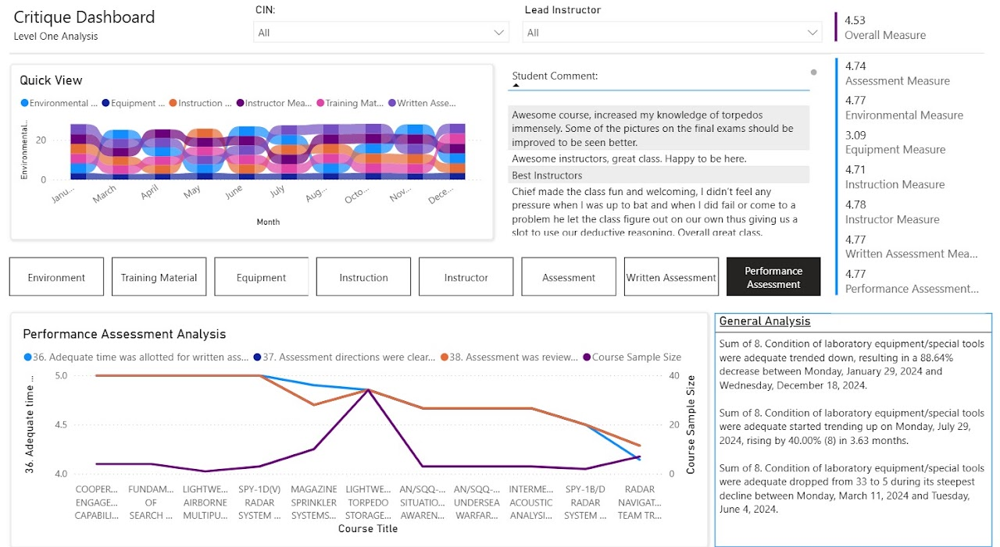

**Overview**

The dashboard tracks various dimensions of training quality environmental, instructional, equipment, assessment measure across months, courses, and instructors. It synthesizes quantitative scores, qualitative comments, and issue trending for comprehensive review.

**Techniques**

Multi-dimensional scorecards enable granular benchmarking of course quality. Visual trend analysis (stacked bar and line charts) provides quick status check and historical context. Text mining of narrative feedback ensures qualitative insight is not lost alongside quantitative rankings. Time-based analytics support evidence-driven interventions and continuous improvement.

**Challenge addressed**

The challenges addressed include sustained declines in laboratory equipment adequacy, variability in the effectiveness of training materials, and potential gaps in assessment clarity or appropriateness. Without continuous critique and data-driven action, instructional improvements may lag, hampering skill acquisition and satisfaction.

**Intended use**

- To provide instructors, course leads, and program managers a holistic look at strengths and weaknesses in course delivery.
- To aggregate comments and scores for actionable feedback loops across multiple training dimensions.
- To visualize measurement trends over time, enabling targeted interventions (e.g., equipment upgrades, refinement of instructional techniques).

[Back to top](#top)

---

### 5. AWT Continuum End of Mission Report Board

**Platform:** Power BI  
**Portfolio label:** Power BI (operation)

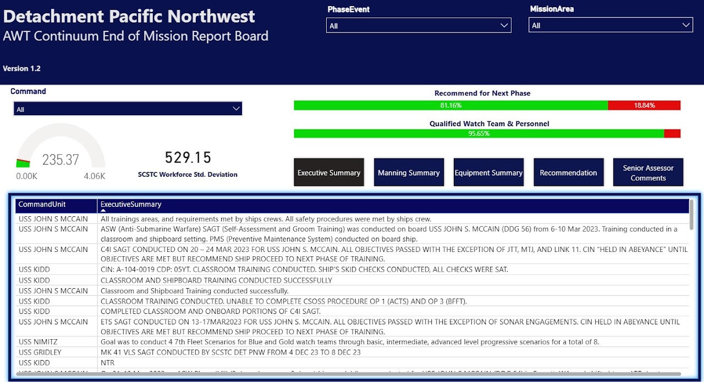

**Overview**

The dashboard summarizes the outcomes and recommendations upon completion of advanced warfare training (AWT) across multiple commands. It centralizes and quantifies data from numerous training phases, covering skills achieved, compliance with requirements, and readiness to progress.

**Techniques**

- Centralized data dashboards drive clarity in reporting and fast decision support.
- Quantitative visuals (progress bars, gauges) support at-a-glance comprehension of complex mission data.
- Integration of detailed textual executive summaries ensures all training phases, exceptions, and recommendations are transparently communicated.
- Modular report navigation (e.g., Manning, Equipment, Recommendation) streamlines access for portfolio and program managers.

**Challenge addressed**

The main issue addressed is ensuring comprehensive, standardized reporting on training status and team readiness. Without systematic end-of-mission analysis, potential gaps in skills, equipment, or safety may go unresolved delaying next-phase certifications and risking mission effectiveness.

**Intended use**

- To aggregate assessments for each vessel, making executive summaries and recommendations clear and accessible.
- To report workforce standard deviation for performance benchmarking and resource allocation.
- To visualize, through progress bars, the percentage of teams recommended for the next training phase and those deemed fully qualified.

[Back to top](#top)

---

### 6. Message Transmittal Summary

**Platform:** Power BI  
**Portfolio label:** Power BI (communication)

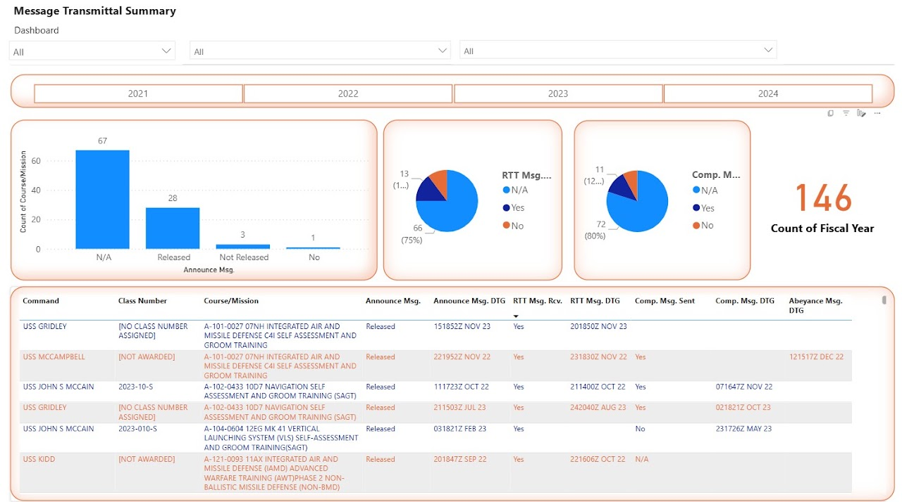

**Overview**

The dashboard presents the annual breakdown of transmittal status for messages related to various training courses and missions. It aggregates both quantitative (counts, pie/bar charts) and qualitative (detailed tabular) data across multiple commands and fiscal years.

**Techniques**

- Aggregating and visualizing communication status using bar and pie charts for prompt portfolio health assessment.
- Integration of tabular logs for root-cause analysis and corrective action planning.
- Use of advanced dashboard tools (Power BI interface features) for filterable, auditable, and scalable project tracking.

**Challenge addressed**

The main challenge tackled is ensuring every course or mission has its required communications (announcement, readiness, completion, abeyance) properly sent, received, and logged. Missing or delayed messages can lead to operational gaps, loss of accountability, and problems in training pipeline management.

**Intended use**

- To summarize and track released, received, and completed messages for all training courses and missions.
- To empower project managers with quick identification of courses/missions lacking required communications.
- To visualize the scope and trend in message delivery, supporting portfolio status reviews and audits.

[Back to top](#top)

---

### 7. AWT Continuum Status Board

**Platform:** Power BI  
**Portfolio label:** Power BI (project-based)

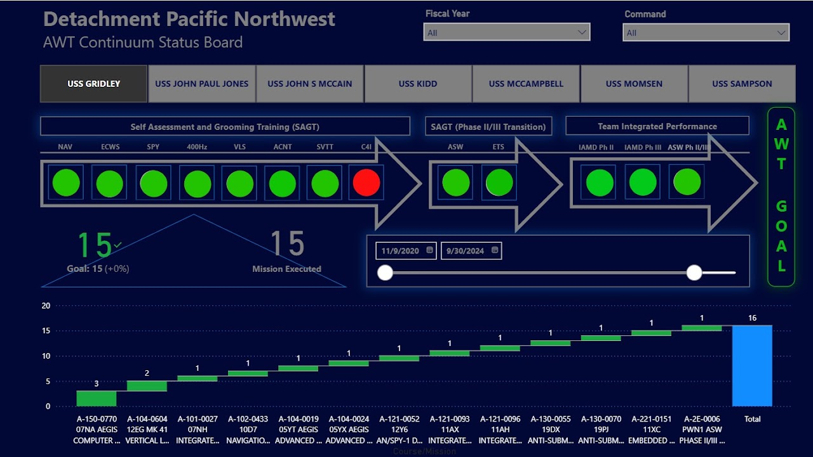

**Overview**

The tool is used to manage the progression and status of Advanced Warfare Training (AWT) being conducted among fleet organizations, with a focus on mission execution milestones and evaluation across a multi-year timeline.

**Techniques**

- Visual management using status dashboards and progress targets, supporting Lean/Six Sigma continuous improvement approaches.
- Real-time data integration to capture mission execution digitally, likely powered by dashboarding platforms (Power BI).
- Sequential process visualization (arrows and color status) to chart phase progression and signal exactly where breakdowns occur.

**Challenge addressed**

A core challenge addressed is ensuring all warfare training phases and evaluations are successfully completed, seamlessly transitioned, and tracked to fulfill mission readiness objectives. Missed or failed modules, such as incomplete Self Assessment and Grooming Training (SAGT), can jeopardize the ship’s ability to meet operational deployment standards.

**Intended use**

- To visually track the completion status of individual and team training modules using traffic light indicators.
- To measure whether the training goal is reached and to confirm mission execution with real-time monitoring.
- To pinpoint areas needing immediate attention (red indicators), enabling rapid response and focused intervention.

[Back to top](#top)

---

### 8. Situation Scoreboard Records App

**Platform:** Power Apps  
**Portfolio label:** Power Apps (records)

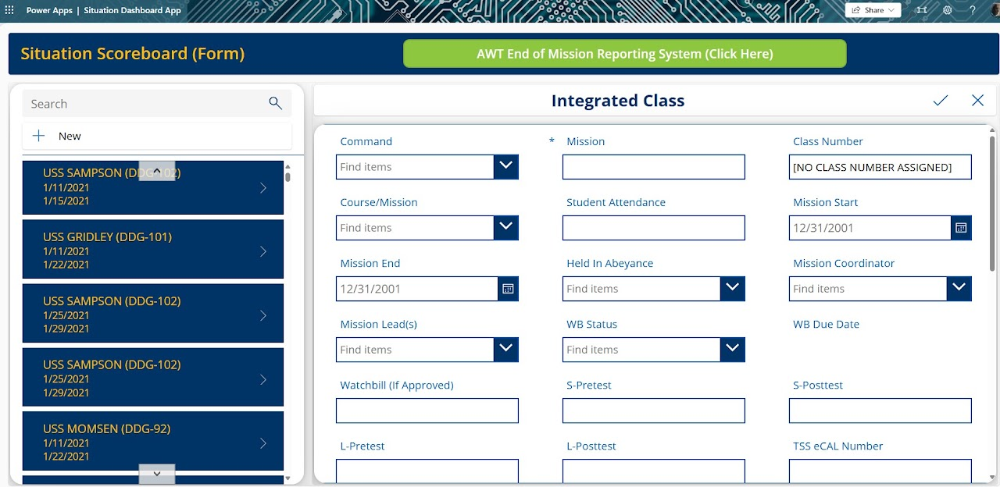

**Overview**

This dashboard app is an interactive tool built on Power Apps for use by staff managing mission data, performance results, and documentation for ships. It serves as a front-end for capturing, reviewing, and updating mission records, scores, and essential information in real time.

**Techniques**

- Microsoft Power Apps for rapid app development, integration with Microsoft 365 data sources, and interactive, permissionable dashboards.
- Modular UI for record navigation and inline data display/editing.
- Real-time synchronization with SharePoint lists or other data sources, supporting dynamic updates and team visibility.
- Embedded system links for rapid access to end-of-mission workflows and compliance tasks.

**Challenge addressed**

The challenge addressed is manual or decentralized tracking of mission data increases the risk of outdated records, poor visibility for leadership, and slow follow-up on mission outcomes or readiness. The need for an integrated, modernized, and user-friendly dashboard app is critical for maintaining operational tempo, audit readiness, and compliance.

**Intended use**

- To provide staff with a centralized, easy-to-use portal for viewing and updating mission-specific data in real time.
- To allow filtering and fast retrieval of detailed mission attributes: ship name, dates, class/missions, coordinators, scores (pre/post-test), status, and critical milestones.
- To link directly to related systems for reporting (e.g., "AWT End of Mission Reporting System" button), supporting seamless workflow and reporting.

[Back to top](#top)

---

### 9. Instructor ePortfolio Summary

**Platform:** Power BI  
**Portfolio label:** Power BI (employee growth performance)

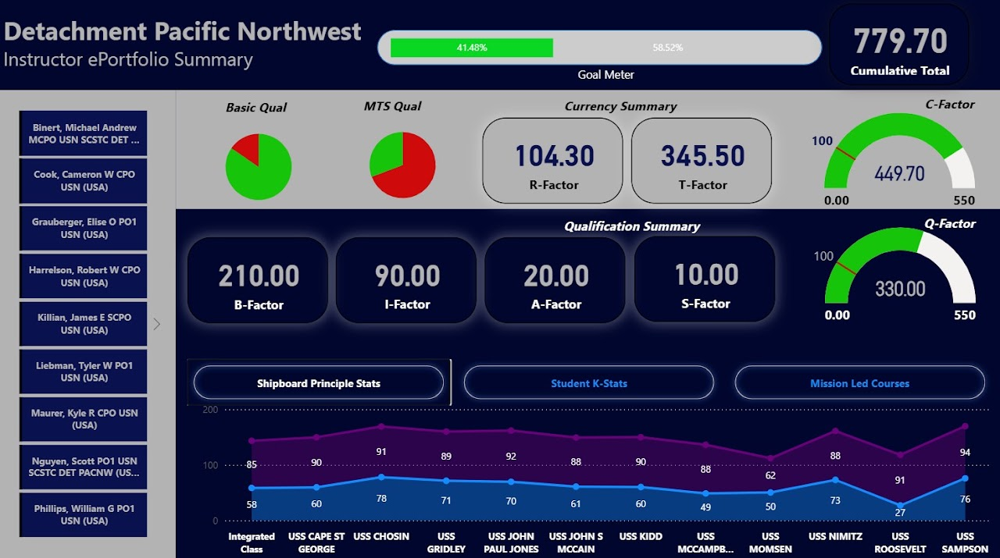

**Overview**

The dashboard aggregates portfolio-wide data on instructor qualifications, currency, performance factors, and student outcomes across multiple vessels and mission types. It is essential for tracking instructor development, operational readiness, and instructional health.

**Techniques**

- Use of multiple performance and qualification indicators for robust, multidimensional talent management.
- Interactive dashboard elements, such as instructor selection and command drill-down, enabling tailored analysis and decision support.
- Data-driven talent development leveraging real-time metrics and visual benchmarks for sustained operational excellence.

**Challenge addressed**

The challenge addressed is ensuring instructors are fully qualified, current, and effective is an ongoing challenge gaps in qualification or performance can directly impede training program success and fleet readiness. Disjointed or incomplete tracking makes it difficult to manage a dynamic, multi-instructor portfolio.

**Intended use**

- To display the qualification rates (e.g., Basic Qual, MTS Qual) for all instructors, quickly surfacing readiness or compliance shortfalls.
- To summarize factors such as B-Factor, I-Factor, A-Factor, and S-Factor, giving a detailed profile of instructional engagement, assessment, and success rates.
- To benchmark instructor and course outcomes across different commands, linking staff performance directly to student and shipboard readiness.

[Back to top](#top)

---

### 10. Effective Directives Library App

**Platform:** Power Apps (SharePoint and Dataverse)  
**Portfolio label:** Power Apps (directive)

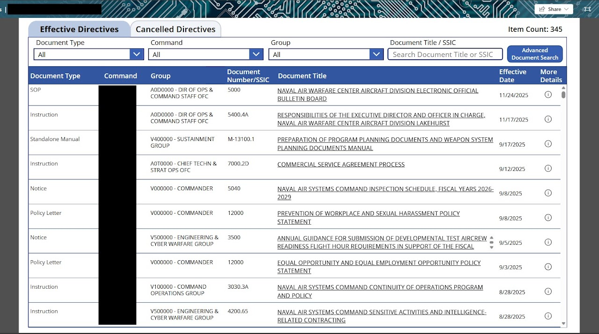

**Overview**

The app provides a centralized list of current and cancelled directives, with filters for document type, command, group, and document title/SSIC, and scope awareness. It allows users to quickly locate authoritative guidance and see effective dates and more details links for each directive.

**Techniques**

- The interface is built in Power Apps, backed by SharePoint and Dataverse, demonstrating low-code application of records management and information governance.
- Structured fields (command, group, SSIC, type) reflect best practices in records classification and retrieval, supporting audits and rapid policy look-ups for staff.
- As a portfolio artifact, it shows capability in designing policy/document control systems, critical for compliance-heavy environments such as defense, aviation, or regulated enterprises.

**Challenge addressed**

The challenge addressed is that large organizations often maintain hundreds of overlapping directives spread across drives and emails, making it hard to know which version is current and in effect. This creates compliance risk, inconsistent practices, and extra workload when staff must manually validate documents.

**Intended use**

- Users select filters (e.g., all Instructions from a specific command group) and then search by keyword or SSIC to refine to the exact directive they need.
- The grid displays document type, command, group, document number/SSIC, title, effective date, and an info icon for detailed metadata or download links.
- The Cancelled Directives tab at the top enables users to distinguish obsolete guidance from currently effective references, preventing misuse of outdated policies.

[Back to top](#top)

---

### 11. Test Analysis Sandbox

**Platform:** Power BI  
**Portfolio label:** Power BI (data research)

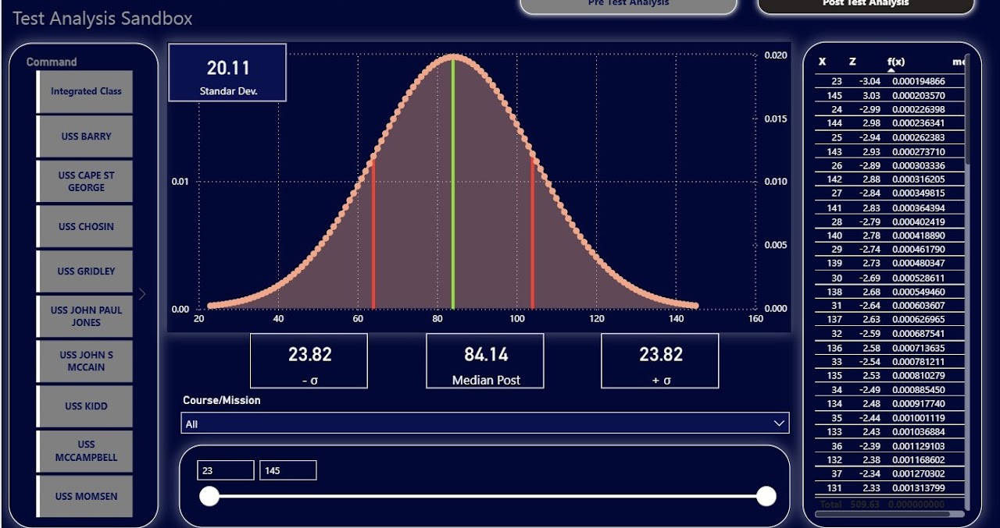

**Overview**

This dashboard visualizes post-test assessment data for various commands, offering a snapshot of performance distribution and outcomes for targeted missions or courses. The visualization is part of a broader effort to monitor and improve training effectiveness within the organization.

**Techniques**

- The dashboard uses statistical analysis (mean, median, standard deviation, Z-score) to interpret training outputs.
- Interactive filters and sliders allow users to segment the data by command or test range.
- Advanced data visualization techniques (bell curves, dynamic highlighting) are employed for clear interpretation.
- Built with the Power BI analytics platform tailored for training data.

**Challenge addressed**

A key challenge addressed is the need to interpret large volumes of test data for actionable insights in training programs. Without centralized statistical analysis, it's difficult to identify trends, variations in performance, or areas requiring instructional intervention.

**Intended use**

- To provide leadership and instructors with a centralized, graphical view of performance data.
- To quickly identify the mean, standard deviation, and spread of scores post-assessment.
- To enable data-driven decisions on where to focus remediation or curriculum updates.

[Back to top](#top)

---

### 12. Training and Readiness Data Pipeline Map

**Platform:** Power BI  
**Portfolio label:** Power BI (pipeline)

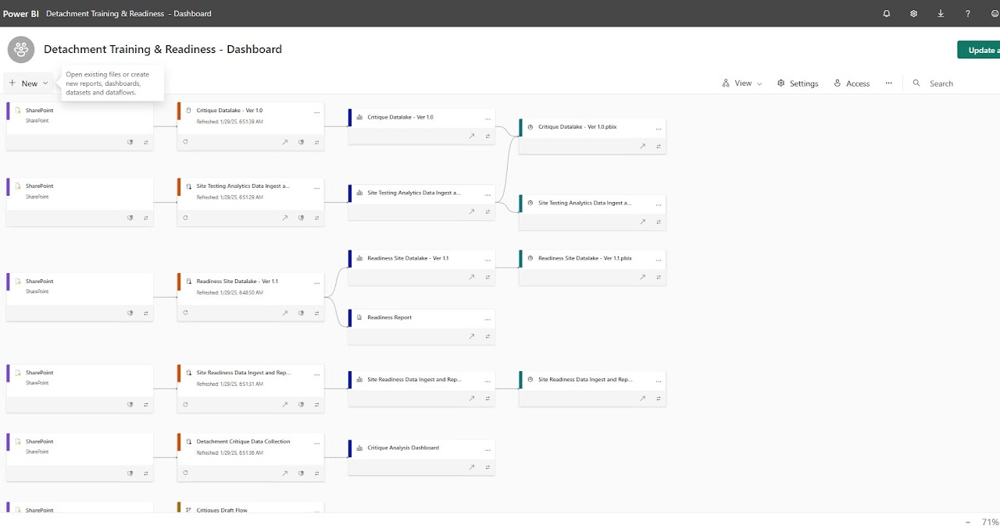

**Overview**

This Power BI dashboard maps the end-to-end data pipeline and reporting strategy supporting detachment training and readiness. It shows how SharePoint and other data inputs feed into analytic datasets (datalakes), which are then processed and visualized in various interactive reports and dashboards for leadership and stakeholders.

**Techniques**

- Microsoft Power BI for business intelligence, with SharePoint as a primary collaborative data repository.
- Modular datalake architecture enables scalable ingestion and transformation before data is exposed to stakeholders in report form.
- Visual mapping of dependencies is a best practice for data governance, supporting agile analytics and compliance with data stewardship requirements.

**Challenge addressed**

The challenge addressed is the complexity of managing disparate data sources and reporting requirements for training and readiness across a naval detachment. Without coordinated integration automated data updates and structured dashboards organizations risk data silos, outdated information, and disconnected analysis across critical readiness metrics.

**Intended use**

- To orchestrate and document all data sources, flows, and dashboard/report instances for training and readiness management.
- To ensure near real-time data refresh and consistency across multiple analytic and reporting products.
- To support transparent, traceable, and centralized reporting for portfolio managers, overseers, and project teams.

[Back to top](#top)

---

### 13. Mission Training Data ETL

**Platform:** Power Query  
**Portfolio label:** Power Query

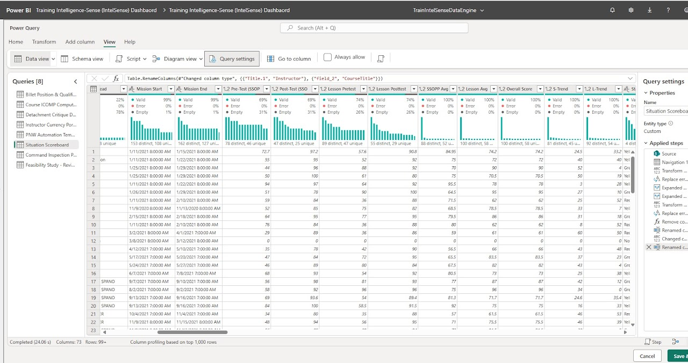

**Overview**

The dashboard helps manage, clean, and analyze a large set of mission training and readiness data. It covers mission details (start/end), test scores (pre, post, average), lesson scores, trends, and overall performance, supporting intelligence-driven decision-making.

**Techniques**

- Use of Power Query for robust ETL (Extract, Transform, Load) preparation, leveraging schema, data profiling, and transformation scripting.
- Integration of multiple raw data sources for holistic visibility covering lessons, scores, assessments, and mission metadata.
- Automated error detection and summary statistics promote fast troubleshooting and targeted corrective actions.

**Challenge addressed**

The challenge addressed is that complex, multi-faceted training programs generate messy, fragmented data across various sources and timeframes. Without proper profiling, validation, and transformation, decision-makers risk basing actions on incomplete or erroneous information, limiting project and portfolio impact.

**Intended use**

- To review, validate, and transform mission, testing, and readiness data before analysis and dashboard reporting.
- To ensure data integrity, flag errors, and spot invalid/empty entries using column profiling (e.g., validity rates per metric).
- To map trends and performance metrics, enabling rapid and reliable portfolio health checks for management teams.

[Back to top](#top)

---

### 14. Training Intelligence Data Model

**Platform:** Power BI (data modeling)  
**Portfolio label:** Power BI (data modeling)

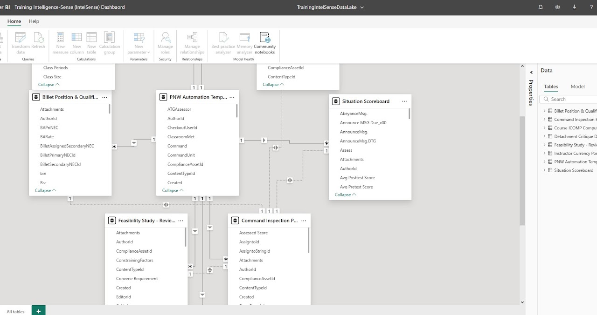

**Overview**

The data model establishes connections between core data tables such as billet qualification mapping, command inspection compliance, automation templates, situation scoreboard, and feasibility studies. This underpins robust, cross-functional analytics for managing and visualizing training, workforce, and compliance data for the organization.

**Techniques**

- Relational data modeling using Power BI's data view, graphical relationship designer, and entity-relationship (ER) conventions.
- Use of surrogate and foreign keys to manage data integrity, enabling slicing/dicing across numerous dimensions (e.g., by command, compliance asset, or event).
- Graphical user interface for maintaining and evolving BI models, ensuring adaptability and transparency in the analytics process.

**Challenge addressed**

The challenge addressed is that maintaining data integrity and seamless analytics in a large-scale training and inspection environment requires coherent, well-structured table relationships. Ad hoc or poorly defined data models result in reporting gaps, inefficiencies, and unreliable insights for portfolio and operational management.

**Intended use**

- To link disparate data sources (personnel billets, compliance, automation, assessment scores, and feasibility studies) for unified, multi-domain analytics.
- To support the training intelligence dashboard with cross-referenced, relational data ensuring accurate drill-downs and trend analysis.
- To enable flexible, many-to-one and one-to-many relationships that power advanced Power BI reporting and business logic.

[Back to top](#top)

---

### 15. Demographic Summary Dashboard

**Platform:** Power BI  
**Portfolio label:** Power BI (production)

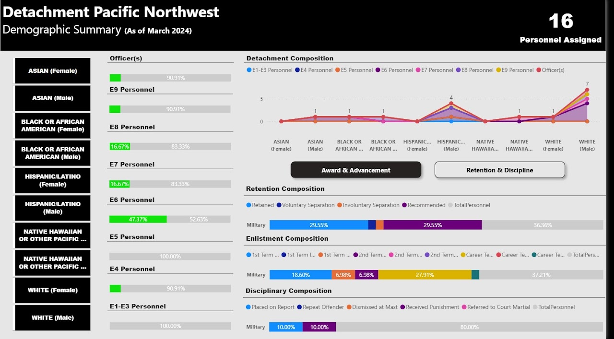

**Overview**

The summary dashboard provides a snapshot of the composition, diversity, and associated trends among the 16 assigned personnel. It covers demographic breakdowns (by gender, ethnicity, and rank), and tracks the distribution across paygrades, retention, advancement, and discipline outcomes.

**Techniques**

- Business intelligence dashboards consolidate demographic, HR, and readiness data for operational and leadership review.
- Use of color-coding and stacked bars/lines for intuitive, stakeholder-friendly communication of complex personnel trends.
- Modular layout supports both broad strategic analysis and granular drill-downs for EO/diversity or HR leaders.

**Challenge addressed**

The challenge addressed is that tracking diversity and personnel demographics, especially in small cohorts, is essential for equitable representation, talent pipeline monitoring, and compliance with diversity initiatives. Without clear, visual analytics, gaps in representation or trends in retention and advancement may go unaddressed, potentially impacting organizational effectiveness and morale.

**Intended use**

- To allow leadership to quickly assess workforce composition by ethnicity, gender, and rank.
- To track retention rates, enlistment and disciplinary trends, supporting targeted human capital interventions.
- To visualize points of concern or improvement (e.g., separation, retention, advancement) for use in portfolio reviews, compliance audits, or diversity/equity strategy sessions.

[Back to top](#top)

---

### 16. Command Inspection Compliance Board

**Platform:** Power BI  
**Portfolio label:** Power BI (compliance)

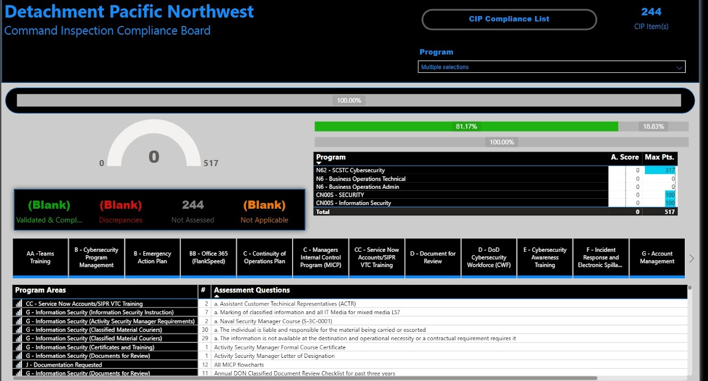

**Overview**

The board aggregates compliance item status across technical, cyber, and security programs, providing visibility on validated items, discrepancies, items not yet assessed, and those deemed not applicable. It serves as a single source of truth during command inspections for the organization.

**Techniques**

- Dashboard-based compliance tracking employs best practices in risk management and regulatory assurance.
- Use of dynamic scoring, status flagging, and progress visualization for actionable insights and leadership buy-in.
- Granular assessment questions promote clarity, traceability, and direct line-of-sight for remediation efforts.

**Challenge addressed**

The challenge addressed is ensuring readiness and compliance with regulatory, technical, and security requirements is complex and failure-prone without dedicated tracking especially across multiple programs and large item lists. Missed or unclear compliance items can lead to inspection failures, operational risk, and regulatory penalties.

**Intended use**

- To monitor command inspection progress in real time, providing transparency on compliance status for various domains.
- To surface validated items versus those requiring further review, immediate correction, or follow-up.
- To support audit trails and accountability for compliance among teams and responsible managers.

[Back to top](#top)

---

### 17. End of Mission Report Automation Flow

**Platform:** Power Automate  
**Portfolio label:** Power Automate

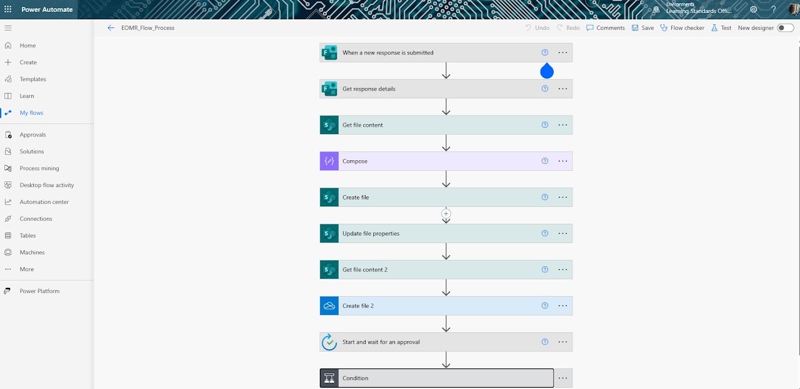

**Overview**

The workflow is designed to streamline mission reporting for the organization, automating repetitive steps that would otherwise burden staff, slow down mission closure, and increase the risk of human error.

**Techniques**

- Power Automate is used for graphical workflow design, automating triggers, branching (conditionals), multi-repository file management, and integrated approval flows.
- Integration with SharePoint and cloud storage enables enterprise-level document management and compliance.
- Modular, reusable workflow patterns make adaptation and scaling straightforward as organizational needs change.

**Challenge addressed**

The challenge addressed is manual processing of post-mission reports can result in delays, lost information, lack of standardized documentation, and lags in the approval process, all of which impact readiness and organizational learning. Automating the workflow ensures that every step is recorded, executed promptly, and traceable for compliance and audit purposes.

**Intended use**

- To automatically trigger collection and processing of EOMR data when a new response is submitted.
- To ensure data flows through key steps: retrieving details, composing/report formatting, creating SharePoint and cloud-based files, updating metadata, and routing for approval.
- To enforce review, conditional logic, and custom file handling shortening the report lifecycle and ensuring no steps are missed.

[Back to top](#top)

---

Source: [Edward's Tech Portfolio — Power Platform Works](https://sites.google.com/view/edwardstechportfolio/power-platform-works)
