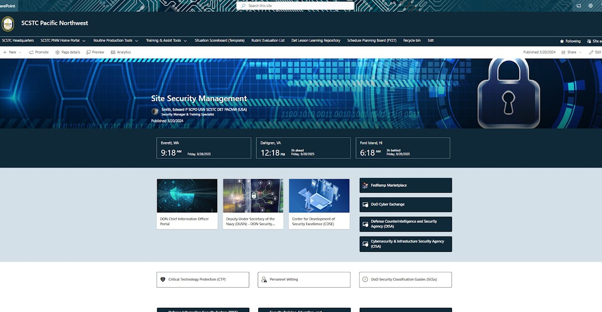
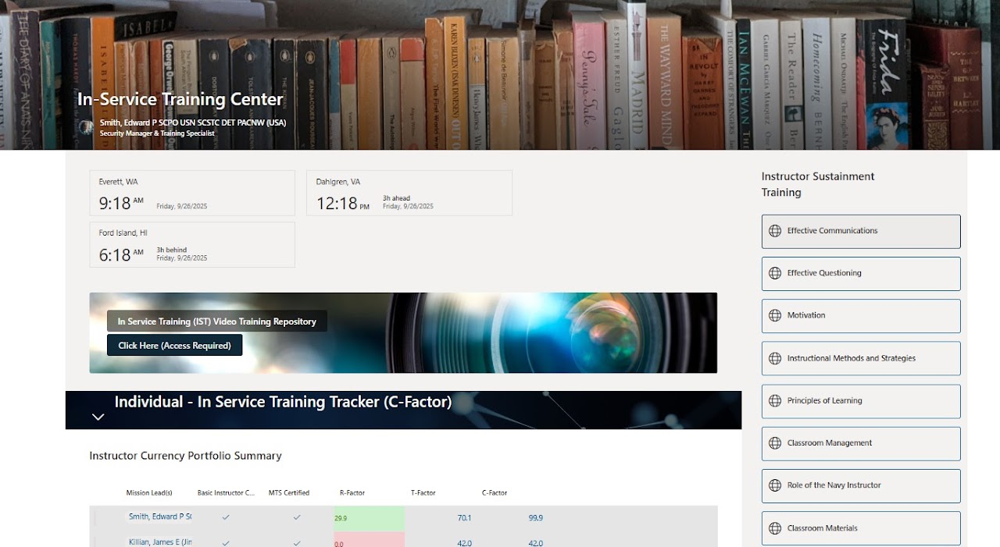
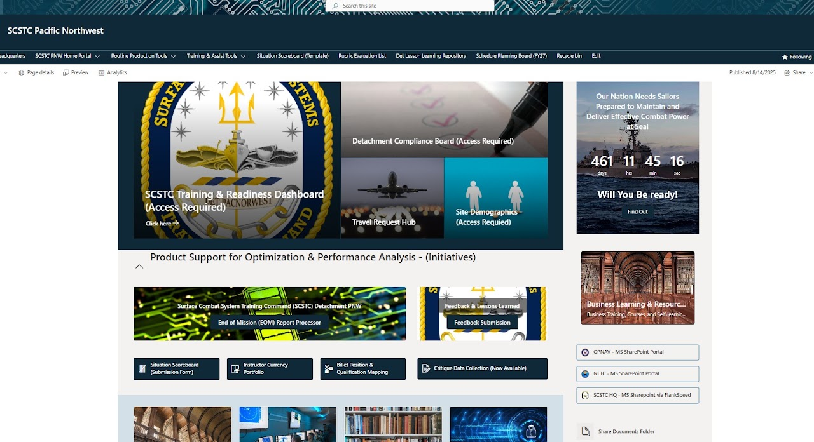
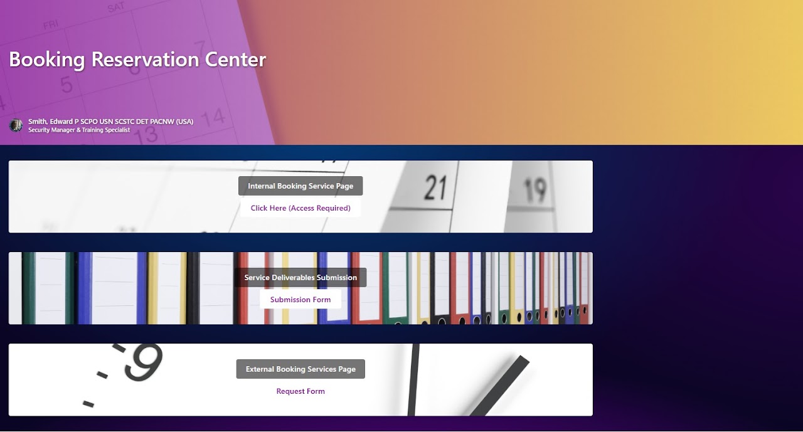
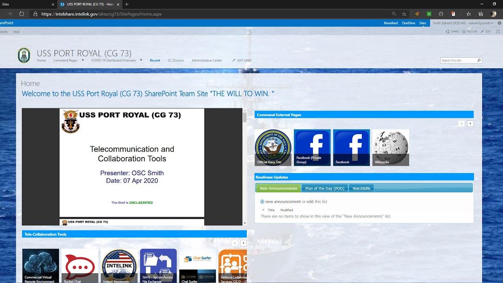
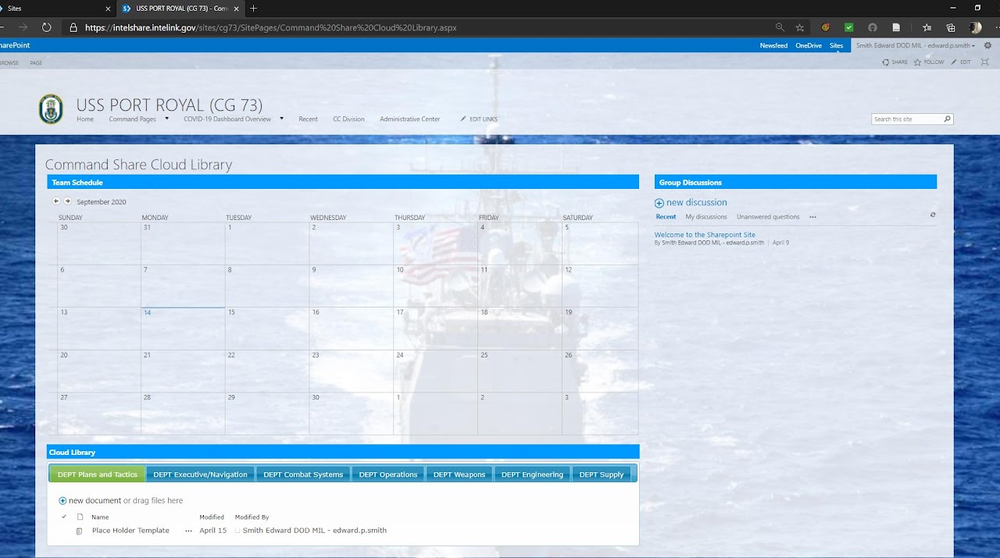
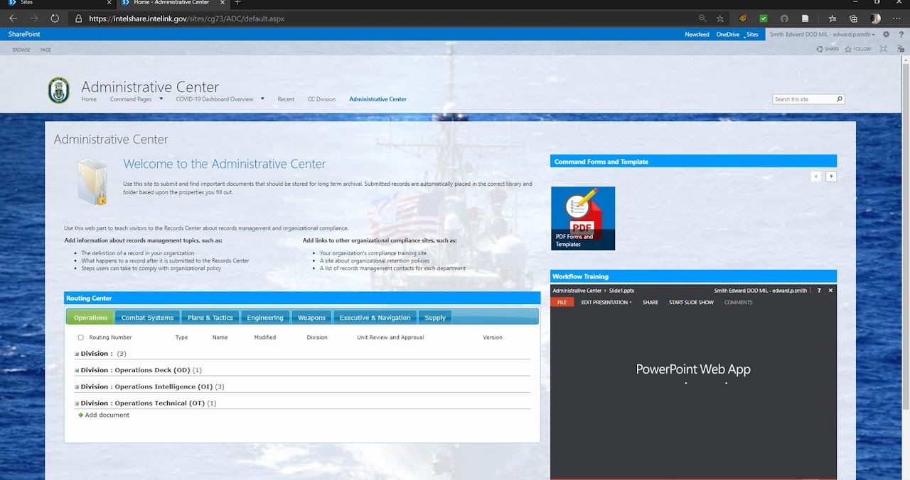

# SharePoint Online Works

[Home](../README.md) · [Power Platform](../power-platform/README.md) · [SharePoint Online](../sharepoint-online/README.md) · [Microsoft Lists](../microsoft-lists/README.md) · [Microsoft Bookings](../microsoft-bookings/README.md) · [Microsoft Excel](../microsoft-excel/README.md) · [Microsoft Teams](../microsoft-teams/README.md) · [Certifications](../certifications/README.md)

Seven SharePoint Online site designs spanning security management hubs, in-service training centers, training-command portals, booking centers, afloat team sites, departmental collaboration libraries, and a records-routing administrative center.

## Contents

1. [Site Security Management Hub](#1-site-security-management-hub)
2. [In-Service Training Center](#2-in-service-training-center)
3. [Training Command Portal](#3-training-command-portal)
4. [Booking Reservation Center](#4-booking-reservation-center)
5. [Afloat Command Team Site Home](#5-afloat-command-team-site-home)
6. [Command Shared Cloud Library](#6-command-shared-cloud-library)
7. [Administrative Center and Routing Center](#7-administrative-center-and-routing-center)

---

### 1. Site Security Management Hub

**Platform:** SharePoint Online  
**Portfolio label:** UI/UX design I

**Overview**

The site supports the work of security managers and specialists by aggregating key security tools, policies, portals, time-zone info, and links to authoritative resources. It helps to coordinate site security efforts across geographically separate commands, providing access to critical management assets, vetting protocols, and guides.

**Techniques**

- Leveraging SharePoint for digital asset management, rapid access control, and security information dissemination.
- Integrating content across multiple federal, DoD, and Navy security programs for holistic compliance assurance.
- Use of modular dashboards, clickable resource blocks, and user-centric UI/UX for speed and usability.
- Embedding agency guidance and support links ensures policies remain current and comprehensive.

**Challenge addressed**

The challenge addressed is security operations involving multiple sites and domains are inherently complex and subject to regulatory and logistical risk when resources and protocols are fragmented. Without a central, easy-to-navigate reference hub, gaps in compliance, delay in vetting, or misunderstanding of requirements can jeopardize site integrity and mission continuity.

**Intended use**

- To deliver all vital links and documents for site security management into one portal for quick, reliable access.
- To synchronize time-zone information for geographically distinct sites, enhancing coordination and reducing scheduling errors.
- To give users one-click navigation to key security and compliance assets, such as classification guides, vetting forms, and CTP protocols.

[Back to top](#top)

---

### 2. In-Service Training Center

**Platform:** SharePoint Online  
**Portfolio label:** UI/UX design II

**Overview**

The portal is used by security and training specialists to coordinate, deliver, and track in-service training (IST) for instructors and staff. It provides quick access to vital training repositories, video libraries, and sustainment content, and is tailored to the multi-site Navy training environment.

**Techniques**

- SharePoint/portal environment for modular, role-based access to training documentation and sustainment learning.
- Integration of tracking sheets and visual dashboards for transparent, real-time compliance auditing.
- Embedded multimedia repositories enable blended and remote learning for distributed training sites.

**Challenge addressed**

The challenge addressed is instructor development and compliance programs require tight monitoring and continual professional growth. Gaps in training, especially for currency and sustainment topics, can lead to degraded instructional effectiveness, compliance risk, and loss of readiness across geographically distributed training teams.

**Intended use**

- To provide a consolidated place for accessing IST video training repositories, ensuring up-to-date professional development.
- To allow transparent tracking of instructor sustainment training (C-Factor) and currency portfolio status for ongoing compliance.
- To make all required sustainment topics instantly accessible communications, questioning, classroom management, Navy policies, motivation for rapid reference and completion.

[Back to top](#top)

---

### 3. Training Command Portal

**Platform:** SharePoint Online  
**Portfolio label:** UI/UX design III

**Overview**

The site serves as the digital gateway for training command personnel and stakeholders, enabling direct access to dashboards, scoreboards, mapping tools, feedback forms, and critical process repositories needed to support continual training, readiness, and operational improvement initiatives.

**Techniques**

- Use of SharePoint's modern site tools for modular, security-aware dashboard portals supporting Lean, Agile, Six Sigma, and Kaizen improvement strategies.
- Integrated feedback and lesson submission forms support closed-loop process evaluation and adaptation.
- Centralized link architecture aggregates business learning, operational planning, and compliance into a single system for scalable stakeholder engagement.

**Challenge addressed**

The challenge addressed is managing complex training, readiness, compliance, and feedback processes across multiple teams demands a centralized, secure, and intuitive digital platform. Fragmented access, disjointed reporting, or lack of real-time insight can degrade agility, slow improvement cycles, or create vulnerabilities in mission assurance.

**Intended use**

- To provide a unified starting point for users to interact with a diverse range of tools (e.g., training dashboards, compliance boards, demographic analytics, request hubs) essential for project portfolio management.
- To streamline workflow for portfolio submissions, billet mapping, critique data collection, lesson repository navigation, and executive reporting.
- To promote transparency, fast access, and analytics-driven process management for all personnel across the organization.

[Back to top](#top)

---

### 4. Booking Reservation Center

**Platform:** SharePoint Online  
**Portfolio label:** UI/UX design IV

**Overview**

The site serves as a centralized interface to streamline scheduling and submission processes for a security-focused organization, involving both internal stakeholders and external clients. It is managed by a Security Manager & Training Specialist, highlighting its operational and compliance importance.

**Techniques**

- Web portal design concepts like role-based access and differentiated workflows support digital transformation of business processes.
- Use of submission forms standardizes deliverable management and improves traceability.
- Integration with service calendars and document repositories ensures all interactions remain on-record and auditable.

**Challenge addressed**

The challenge addressed is managing bookings for training, service deliverables, and requests, which often face issues such as fragmented workflows, delayed submissions, and miscommunication across teams and external parties. Without a unified digital hub, requests and documentation may become bottlenecked, impacting timeliness and accountability.

**Intended use**

- To facilitate secure, organized reservation processes for both internal and external services.
- To provide a controlled pathway for service deliverable submission, maintaining audit trails and compliance standards.
- To reduce administrative friction by bringing all booking and submission interfaces into a single web-accessible portal.

[Back to top](#top)

---

### 5. Afloat Command Team Site Home

**Platform:** SharePoint (team site)  
**Portfolio label:** UI/UX design V

**Overview**

The home page welcomes users to the SharePoint team site, branded with ship imagery and the motto. It surfaces key content areas such as command pages, COVID-19 dashboard overview, and an administrative center, giving sailors a central digital hub for daily information.

**Techniques**

- The solution demonstrates SharePoint site design, including page layouts, content web parts, embedded slide decks, list web parts, and tile navigation.
- Reflects good information architecture and knowledge management practices for afloat commands centralizing tools, announcements, and collaboration links under a branded, mission-focused portal.

**Challenge addressed**

The challenge addressed is a deployed or underway ship needs reliable, low-bandwidth tools for internal communication, training distribution, and quick access to collaboration links; relying on email or disparate portals makes information hard to find and inconsistently shared. This SharePoint site solves that by consolidating announcements, briefs, collaboration links, and readiness tools into a single, structured location.

**Intended use**

- The featured slide displays a telecommunication and collaboration tools brief for the crew, embedding presentation content directly on the home page for easy access.
- “Command External Pages” tiles link out to official Navy sites, Facebook groups, and reference resources, giving sailors curated external navigation.
- Readiness Updates, New Announcements, and “Plan of the Day” lists support day-to-day operational communication, including watchbills and other time-sensitive information.

[Back to top](#top)

---

### 6. Command Shared Cloud Library

**Platform:** SharePoint (team site)  
**Portfolio label:** UI/UX design VI

**Overview**

The page combines a Team Schedule calendar, a Group Discussions area, and a Cloud Library of departmental folders such as DEPT Plans and Tactics, Executive/Navigation, Combat Systems, Operations, Weapons, Engineering, and Supply. It provides a single digital workspace where watch sections, departments, and leaders can coordinate activities and share files while underway or in port.

**Techniques**

- This solution demonstrates SharePoint customization using calendar web parts, discussion boards, and document libraries organized by department for clear information architecture.
- Reflects strong knowledge management and collaboration design for afloat commands, ensuring that critical information, plans, and conversations are preserved, searchable, and available across the command team.

**Challenge addressed**

The challenge addressed is without a unified collaboration hub, departments tend to maintain separate calendars and file repositories, making it difficult for the organization to maintain shared situational awareness and configuration control over critical plans and products. This fragmentation increases the risk of outdated documents, missed events, and misalignment between warfare areas.

**Intended use**

- The Team Schedule calendar displays monthly events and can be populated with drills, inspections, training, and key milestones for all hands visibility.
- Group Discussions allow crew members to start new discussion threads and track “recent,” “my discussions,” and “unanswered” topics, supporting asynchronous coordination.
- The Cloud Library section provides drag-and-drop document upload into department-specific folders, enabling controlled sharing of tactics, navigation guidance, combat systems documentation, and logistics files.

[Back to top](#top)

---

### 7. Administrative Center and Routing Center

**Platform:** SharePoint (records center)  
**Portfolio label:** UI/UX design VII

**Overview**

The page welcomes users to the Administrative Center and explains its purpose: submitting and locating important documents that require long-term archival in the correct library and folder. It also introduces records-management guidance and links to broader organizational compliance content, helping departments follow retention and documentation policy.

**Techniques**

- This solution illustrates SharePoint records center design, combining document libraries, metadata routing, and instructional content on a single page.
- Reflects strong governance and knowledge-management practices for naval commands, ensuring that operational documents are correctly routed, versioned, and archived for compliance and historical reference.

**Challenge addressed**

The challenge addressed is administration must manage large volumes of records operations decks, intelligence summaries, technical documents while meeting retention and routing requirements; doing this via email or ad-hoc folders risks misfiled records, lost approvals, and audit failures. A structured records and routing center is needed to ensure documents are stored consistently and traceably across all divisions.

**Intended use**

- The Routing Center organizes documents by tabs for Operations, Combat Systems, Plans & Tactics, Engineering, Weapons, Executive & Navigation, and Supply, each with routing numbers, division, review/approval, and version metadata.
- A Command Forms and Template tile links to standardized PDFs, ensuring everyone uses approved templates.
- The Workflow Training pane embeds a PowerPoint Web App presentation that trains users on how to use the Administrative Center and routing processes.

[Back to top](#top)

---

Source: [Edward's Tech Portfolio — SharePoint Online Works](https://sites.google.com/view/edwardstechportfolio/sharepoint-online-works)
